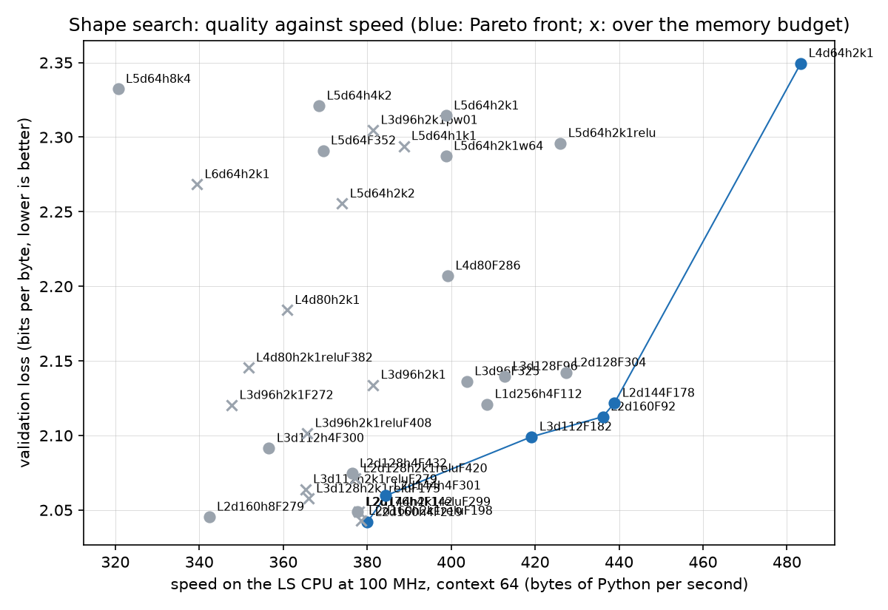

# LS-LLM: a language model that writes Python on the LS 8-bit CPU

Final report. Generated by `tools/report.py runs/final.json`; every number is read from a file that a run wrote
(`results/results.jsonl`, `runs/*/result.json`, the exported integer model, the generated LS program).
Practice-set scores and benchmark scores are in separate tables and are never mixed.

## 1. Summary

- **Model (Tier A).** 350,880 trained parameters, all carried by int8 values (350,080 int8 matrix entries; the 800 gains of the norms are folded into matrices and tables): 2 layers, width 160, 4 query heads sharing 1 key/value head, ReLU feed-forward of 219, 512 tokens, context 256. Its complete data memory image is 450,432 bytes (110 of the 135 block RAMs, plus one for the program), the program 976 words.
- **Speed (level L1, 100 MHz, greedy with the syntax filter).** 495,456 / 549,600 / 766,176 cycles per token = **202 / 182 / 131 tokens per second** at context 16 / 64 / 256. The stream instruction makes the same program 3.20 / 3.15 / 3.02 times faster than one classic 4-cycle `MAC` per product.
- **Integer arithmetic.** Validation loss 2.1770 nats per token in float and 2.2376 with the integers that the CPU computes (+0.0606); training forward pass, integer reference and generated LS program give identical tokens.
- **Scores on the test sets** (pass@1 greedy, best of filter on and off; pass@10 from 10 samples at temperature 0.8). Every model went
  through the same harness; the comparators are public models run as published. Details and the ladder below pass@1: section 3.

  | model | parameters | custom 200 | MBPP | HumanEval | custom: near families, tasks passed of 120 | custom: far families, of 80 | custom 200 pass@10 | MBPP pass@10 | HumanEval pass@10 |
  |---|---|---|---|---|---|---|---|---|---|
  | **Tier A, float** | 350,880 | 4.0% | 0.8% | 0.0% | 7 | 1 | 12.0% | 0.8% | 0.0% |
  | **Tier A, int8 (what the CPU computes)** | 350,880 | 7.5% | 0.2% | 0.0% | 14 | 1 | 13.0% | 0.8% | 0.0% |
  | **Tier A, earlier model (10,000 steps; the editing sessions used it), float** | 350,880 | 4.5% | 0.4% | 0.0% | 9 | 0 | 6.0% | 0.8% | 0.0% |
  | **Tier A, earlier model (10,000 steps; the editing sessions used it), int8 (what the CPU computes)** | 350,880 | 5.0% | 0.2% | 0.0% | 10 | 0 | 9.5% | 0.6% | 0.0% |
  | **Tier B, float** | 1,252,032 | 5.5% | 0.6% | 0.6% | 11 | 0 | 13.0% | 1.4% | 0.0% |
  | **Tier B, int8 (what the CPU computes)** | 1,252,032 | 5.0% | 0.4% | 0.6% | 10 | 0 | 14.0% | 2.2% | 0.6% |
  | stories260K | 260,032 | 0.0% | 0.0% | 0.0% | 0 | 0 | - | - | - |
  | ngram-432KB | 77,988 | 0.0% | 0.0% | 0.0% | 0 | 0 | - | - | - |
  | Pico-1 | 254,400 | 0.0% | 0.0% | 0.0% | 0 | 0 | 0.0% | 0.0% | 0.0% |
  | Pico-1.2 | 460,608 | 0.0% | 0.0% | 0.0% | 0 | 0 | 0.0% | 0.0% | 0.0% |
  | CinnabarLM-4M-Python-Base | 4,229,568 | 1.0% | 0.6% | 0.0% | 2 | 0 | - | - | - |
  | Pico-1.3-Coding-Large | 6,917,376 | 8.5% | 1.6% | 0.6% | 11 | 6 | - | - | - |
  | chispa-20m-python | 20,119,360 | 5.0% | - | - | 7 | 3 | - | - | - |

  Near families are kinds of task that the generated part of the training text also covers (other tasks, same kind); far families are not.
  Our models pass near-family tasks and at most 1 far-family task. The two larger public models pass several far-family tasks.

- **Programs on request (board model, int8, on the simulated CPU).** Of 401 requests such as "make me a bubble sort program", 400 come back as a program that passes the tests of its request; in all 401 the CPU program sends exactly the tokens of the integer reference. Median 0.33 s per program at 100 MHz, longest 1.54 s. This is recall of programs the board model was trained on, not a benchmark (section 3).
- **Weight editing without gradients (4 sessions, on the earlier Tier A model).** Practice scores rose, the held-out custom score did not: 5.0% unedited, 4.0%, 4.0%, 4.5%, 3.5% after the sessions. No edited model is used (section 10).
- **What was not done.** Nothing ran on the board or in Vivado; cycle counts come from a simulator of the proposed CPU (section 13).

## 2. The model in one table

Tier A is the main model: everything it needs is in block RAM. Tier B keeps its weights in the DDR2 (section 12).
Cycles and tokens per second: level L1 of `docs/SPEC.md`, 100 MHz, complete program, greedy decoding with the syntax filter.

| model | layers | width | heads / KV heads | feed-forward | window | parameters | data memory on the CPU (bytes) | program (words) | validation text | val loss float, all tokens (nats/token) | val loss int8, all tokens | int8 after calibration only | val loss on body tokens: float / int8 | bits per byte float / int8 | cycles per token @16 / @64 / @256 | tokens/s @16 / @64 / @256 | stream speed-up vs classic MAC @16 / @64 / @256 |
|---|---|---|---|---|---|---|---|---|---|---|---|---|---|---|---|---|---|
| Tier A | 2 | 160 | 4 / 1 | relu, 219 | - | 350,880 | 450,432 | 976 | self-contained functions (val2) | 2.1770 | 2.2376 | 2.2432 | 1.7248 / 1.7856 | 1.4512 / 1.4916 | 495,456 / 549,600 / 766,176 | 201.8 / 182.0 / 130.5 | 3.20 / 3.15 / 3.02 |
| Tier A, earlier model (10,000 steps; the editing sessions used it) | 2 | 160 | 4 / 1 | relu, 219 | - | 350,880 | 450,432 | 976 | self-contained functions (val2) | 2.2212 | 2.2543 | 2.3246 | 1.7915 / 1.8302 | 1.4807 / 1.5027 | 495,456 / 549,600 / 766,176 | 201.8 / 182.0 / 130.5 | 3.20 / 3.15 / 3.02 |
| Tier B | 4 | 192 | 4 / 1 | relu, 510 | - | 1,252,032 | 1,350,336 | - | self-contained functions (val2) | 1.8886 | 1.9068 | 1.9502 | 1.4767 / 1.4921 | 1.2589 / 1.2711 | see docs/TIER_B.md | see docs/TIER_B.md | - |

Shape of Tier A: 2 layers, width 160, 4 query heads on 1 key/value head, ReLU feed-forward of 219, vocabulary 512, context 256; 350,880 parameters, all int8.
Validation loss on the same 79,082 validation tokens: float 2.1770 nats per token, int8 2.2376 (straight after calibration, before
quantization-aware training: 2.2432). The int8 number is the loss of the integers that the CPU computes: the training
forward pass and the integer reference gave identical logits on the check windows (`bit_exact`: True).

## 3. Benchmark scores

HumanEval (164 tasks), MBPP test split (500 tasks) and the custom set of 200 very simple tasks (test half). pass@1 with
greedy decoding, and pass@1 / pass@10 from 10 samples per task at temperature 0.8 (unbiased estimator). `syntax ok` =
the completed function parses, `runs ok` = it runs through the tests without an exception (they may still fail).
Generated code was executed only inside the sandbox (`lsllm/sandbox.py`, no network, no file access, time limit).
Every model went through the same harness, the same prompts and the same budget of new tokens.

| model | arithmetic | weight edit | syntax filter | decoding | custom 200 pass@1 | custom 200 pass@10 | custom 200 syntax ok | custom 200 runs ok | MBPP pass@1 | MBPP pass@10 | MBPP syntax ok | MBPP runs ok | HumanEval pass@1 | HumanEval pass@10 | HumanEval syntax ok | HumanEval runs ok |
|---|---|---|---|---|---|---|---|---|---|---|---|---|---|---|---|---|
| Tier A | float | - | off | greedy | 4.0% | - | 93.0% | 43.0% | 0.8% | - | 80.4% | 34.2% | 0.0% | - | 51.2% | 16.5% |
| Tier A | float | - | off | 10 samples, T = 0.8 | 3.6% | 12.0% | 88.1% | 39.4% | 0.1% | 0.8% | 67.6% | 16.9% | 0.0% | 0.0% | 49.0% | 7.3% |
| Tier A | float | - | on | greedy | 4.0% | - | 95.0% | 43.5% | 0.8% | - | 87.4% | 35.6% | 0.0% | - | 55.5% | 17.1% |
| Tier A | float | - | on | 10 samples, T = 0.8 | 3.5% | 11.5% | 91.0% | 40.0% | 0.1% | 0.8% | 71.5% | 17.4% | 0.0% | 0.0% | 54.9% | 8.2% |
| Tier A | int8 | - | off | greedy | 7.5% | - | 92.5% | 47.0% | 0.2% | - | 82.2% | 33.8% | 0.0% | - | 62.2% | 22.0% |
| Tier A | int8 | - | off | 10 samples, T = 0.8 | 5.5% | 13.0% | 86.5% | 40.8% | 0.2% | 0.8% | 67.5% | 17.2% | 0.0% | 0.0% | 48.2% | 10.5% |
| Tier A | int8 | - | on | greedy | 7.5% | - | 93.5% | 47.5% | 0.2% | - | 88.4% | 35.0% | 0.0% | - | 68.3% | 25.0% |
| Tier A | int8 | - | on | 10 samples, T = 0.8 | 5.5% | 13.0% | 88.8% | 41.3% | 0.2% | 0.8% | 74.0% | 18.0% | 0.0% | 0.0% | 57.2% | 11.3% |
| Tier A, earlier model (10,000 steps; the editing sessions used it) | float | - | off | greedy | 4.5% | - | 88.5% | 38.5% | 0.4% | - | 71.2% | 36.8% | 0.0% | - | 60.4% | 28.7% |
| Tier A, earlier model (10,000 steps; the editing sessions used it) | float | - | off | 10 samples, T = 0.8 | 2.1% | 6.0% | 82.8% | 30.1% | 0.1% | 0.8% | 58.5% | 13.5% | 0.0% | 0.0% | 43.2% | 7.3% |
| Tier A, earlier model (10,000 steps; the editing sessions used it) | float | - | on | greedy | 4.5% | - | 91.5% | 39.5% | 0.4% | - | 81.8% | 39.4% | 0.0% | - | 64.0% | 29.3% |
| Tier A, earlier model (10,000 steps; the editing sessions used it) | float | - | on | 10 samples, T = 0.8 | 2.1% | 6.0% | 86.9% | 30.9% | 0.1% | 0.8% | 64.4% | 14.2% | 0.0% | 0.0% | 49.6% | 8.7% |
| Tier A, earlier model (10,000 steps; the editing sessions used it) | int8 | - | off | greedy | 5.0% | - | 86.0% | 40.0% | 0.2% | - | 72.4% | 30.8% | 0.0% | - | 56.1% | 17.7% |
| Tier A, earlier model (10,000 steps; the editing sessions used it) | int8 | - | off | 10 samples, T = 0.8 | 3.2% | 9.5% | 82.0% | 33.5% | 0.1% | 0.6% | 58.9% | 15.6% | 0.0% | 0.0% | 45.9% | 9.8% |
| Tier A, earlier model (10,000 steps; the editing sessions used it) | int8 | - | on | greedy | 5.0% | - | 90.5% | 40.0% | 0.2% | - | 80.8% | 33.0% | 0.0% | - | 59.1% | 18.9% |
| Tier A, earlier model (10,000 steps; the editing sessions used it) | int8 | - | on | 10 samples, T = 0.8 | 3.2% | 9.5% | 86.9% | 34.4% | 0.1% | 0.6% | 66.0% | 17.0% | 0.0% | 0.0% | 53.6% | 11.3% |
| Tier A, earlier model (10,000 steps; the editing sessions used it) | int8 | session s1 | on | greedy | 4.0% | - | 90.5% | 40.0% | 0.2% | - | 75.2% | 32.4% | 0.0% | - | 62.8% | 18.9% |
| Tier A, earlier model (10,000 steps; the editing sessions used it) | int8 | session s2 | on | greedy | 4.0% | - | 91.5% | 47.5% | 0.0% | - | 87.0% | 38.8% | 0.0% | - | 74.4% | 23.8% |
| Tier A, earlier model (10,000 steps; the editing sessions used it) | int8 | session s3 | on | greedy | 4.5% | - | 92.5% | 45.0% | 0.0% | - | 81.6% | 36.6% | 0.0% | - | 65.9% | 22.0% |
| Tier A, earlier model (10,000 steps; the editing sessions used it) | int8 | session s4 | on | greedy | 3.5% | - | 84.5% | 45.5% | 0.4% | - | 86.0% | 40.4% | 0.0% | - | 82.3% | 54.3% |
| Tier B | float | - | off | greedy | 5.5% | - | 94.5% | 49.0% | 0.6% | - | 78.0% | 40.6% | 0.6% | - | 60.4% | 35.4% |
| Tier B | float | - | off | 10 samples, T = 0.8 | 5.3% | 13.0% | 91.0% | 43.2% | 0.3% | 1.4% | 70.5% | 24.0% | 0.0% | 0.0% | 60.4% | 14.3% |
| Tier B | float | - | on | greedy | 5.5% | - | 96.5% | 50.0% | 0.6% | - | 78.6% | 40.8% | 0.6% | - | 64.0% | 36.6% |
| Tier B | float | - | on | 10 samples, T = 0.8 | 5.3% | 13.0% | 92.7% | 43.4% | 0.3% | 1.4% | 73.5% | 24.5% | 0.0% | 0.0% | 63.0% | 14.7% |
| Tier B | int8 | - | off | greedy | 5.0% | - | 92.5% | 46.5% | 0.4% | - | 81.6% | 46.6% | 0.6% | - | 62.8% | 24.4% |
| Tier B | int8 | - | off | 10 samples, T = 0.8 | 5.5% | 14.0% | 91.2% | 46.0% | 0.4% | 2.0% | 74.0% | 28.8% | 0.1% | 0.6% | 61.1% | 15.5% |
| Tier B | int8 | - | on | greedy | 5.0% | - | 94.0% | 47.0% | 0.4% | - | 83.6% | 47.2% | 0.6% | - | 65.2% | 24.4% |
| Tier B | int8 | - | on | 10 samples, T = 0.8 | 5.5% | 14.0% | 92.8% | 46.2% | 0.4% | 2.2% | 78.0% | 29.7% | 0.1% | 0.6% | 68.4% | 16.3% |
| stories260K (karpathy/tinyllamas, as published) | float | - | off | greedy | 0.0% | - | 62.0% | 62.0% | 0.0% | - | 55.6% | 55.4% | 0.0% | - | 28.7% | 28.7% |
| ngram-432KB | n-gram | - | off | greedy | 0.0% | - | 23.0% | 0.0% | 0.0% | - | 32.2% | 0.0% | 0.0% | - | 62.8% | 0.0% |
| Pico-1 (as published, plain continuation) | float | - | off | greedy | 0.0% | - | 0.0% | 0.0% | 0.0% | - | 0.0% | 0.0% | 0.0% | - | 7.9% | 6.7% |
| Pico-1 (as published, plain continuation) | float | - | off | 10 samples, T = 0.8 | 0.0% | 0.0% | 0.7% | 0.5% | 0.0% | 0.0% | 0.4% | 0.4% | 0.0% | 0.0% | 0.9% | 0.4% |
| Pico-1.2 (as published, plain continuation) | float | - | off | greedy | 0.0% | - | 3.0% | 3.0% | 0.0% | - | 0.6% | 0.6% | 0.0% | - | 22.6% | 22.6% |
| Pico-1.2 (as published, plain continuation) | float | - | off | 10 samples, T = 0.8 | 0.0% | 0.0% | 5.4% | 5.2% | 0.0% | 0.0% | 6.4% | 6.4% | 0.0% | 0.0% | 13.9% | 12.7% |
| CinnabarLM-4M-Python-Base (as published, plain continuation) | float | - | off | greedy | 1.0% | - | 92.0% | 64.5% | 0.6% | - | 85.8% | 63.2% | 0.0% | - | 52.4% | 22.0% |
| Pico-1.3-Coding-Large (as published, plain continuation) | float | - | off | greedy | 8.5% | - | 84.5% | 58.0% | 1.6% | - | 66.0% | 23.0% | 0.6% | - | 57.9% | 20.7% |
| chispa-20m-python (as published, plain continuation) | float | - | off | greedy | 5.0% | - | 93.0% | 63.5% | - | - | - | - | - | - | - | - |

### The custom set by stratum

The 200 custom tasks come from 40 families. For 24 families (120 tasks, "near") the generated training text contains
functions of the same kind, though never the task itself; for 16 families (80 tasks, "far") it contains nothing of the
kind. A pass on a near task shows what was learned, a pass on a far task would show generalisation. Greedy decoding.

| model | arithmetic | weight edit | syntax filter | near families: passed of 120 | far families: passed of 80 |
|---|---|---|---|---|---|
| A2 | float | - | off | 9 (7.5%) | 0 (0.0%) |
| A2 | float | - | on | 9 (7.5%) | 0 (0.0%) |
| A2q | int8 | - | off | 10 (8.3%) | 0 (0.0%) |
| A2q | int8 | - | on | 10 (8.3%) | 0 (0.0%) |
| A2q | int8 | session s1 | on | 8 (6.7%) | 0 (0.0%) |
| A2q | int8 | session s2 | on | 8 (6.7%) | 0 (0.0%) |
| A2q | int8 | session s3 | on | 9 (7.5%) | 0 (0.0%) |
| A2q | int8 | session s4 | on | 7 (5.8%) | 0 (0.0%) |
| A3r | float | - | off | 7 (5.8%) | 1 (1.2%) |
| A3r | float | - | on | 7 (5.8%) | 1 (1.2%) |
| A3ru2 | int8 | - | off | 14 (11.7%) | 1 (1.2%) |
| A3ru2 | int8 | - | on | 14 (11.7%) | 1 (1.2%) |
| B2 | float | - | off | 11 (9.2%) | 0 (0.0%) |
| B2 | float | - | on | 11 (9.2%) | 0 (0.0%) |
| B2q | int8 | - | off | 10 (8.3%) | 0 (0.0%) |
| B2q | int8 | - | on | 10 (8.3%) | 0 (0.0%) |
| CinnabarLM-4M-Python-Base (as published, plain continuation) | float | - | off | 2 (1.7%) | 0 (0.0%) |
| Pico-1 (as published, plain continuation) | float | - | off | 0 (0.0%) | 0 (0.0%) |
| Pico-1.2 (as published, plain continuation) | float | - | off | 0 (0.0%) | 0 (0.0%) |
| Pico-1.3-Coding-Large (as published, plain continuation) | float | - | off | 11 (9.2%) | 6 (7.5%) |
| chispa-20m-python (as published, plain continuation) | float | - | off | 7 (5.8%) | 3 (3.8%) |
| ngram-432KB | n-gram | - | off | 0 (0.0%) | 0 (0.0%) |
| stories260K (karpathy/tinyllamas, as published) | float | - | off | 0 (0.0%) | 0 (0.0%) |

### Practice-set scores (not benchmark scores)

These tasks were used to make decisions (shape, data mix, decoding, weight edits). They are shown so that the decisions can be checked.

| model | arithmetic | weight edit | syntax filter | decoding | custom 200 pass@1 | custom 200 pass@10 | custom 200 syntax ok | custom 200 runs ok | MBPP pass@1 | MBPP pass@10 | MBPP syntax ok | MBPP runs ok | HumanEval pass@1 | HumanEval pass@10 | HumanEval syntax ok | HumanEval runs ok |
|---|---|---|---|---|---|---|---|---|---|---|---|---|---|---|---|---|
| Tier A | float | - | off | greedy | 2.5% | - | 92.5% | 48.0% | 0.6% | - | 83.2% | 40.3% | - | - | - | - |
| Tier A | float | - | off | 10 samples, T = 0.8 | 2.2% | 7.0% | 86.8% | 37.3% | 0.3% | 1.1% | 67.6% | 19.1% | - | - | - | - |
| Tier A | float | - | on | greedy | 2.5% | - | 94.5% | 48.5% | 0.6% | - | 87.3% | 41.4% | - | - | - | - |
| Tier A | float | - | on | 10 samples, T = 0.8 | 2.2% | 7.0% | 89.2% | 37.6% | 0.3% | 1.3% | 72.0% | 19.7% | - | - | - | - |
| Tier A | int8 | - | off | greedy | 3.0% | - | 90.5% | 52.0% | 0.4% | - | 83.2% | 34.3% | - | - | - | - |
| Tier A | int8 | - | off | 10 samples, T = 0.8 | 3.1% | 7.5% | 85.5% | 37.0% | 0.3% | 0.9% | 67.7% | 18.8% | - | - | - | - |
| Tier A | int8 | - | on | greedy | 3.0% | - | 95.5% | 53.5% | 0.4% | - | 87.3% | 35.1% | - | - | - | - |
| Tier A | int8 | - | on | 10 samples, T = 0.8 | 3.2% | 7.5% | 88.8% | 38.1% | 0.3% | 0.9% | 73.8% | 19.5% | - | - | - | - |
| Tier A, earlier model (10,000 steps; the editing sessions used it) | float | - | off | greedy | 1.5% | - | 89.0% | 36.5% | 0.6% | - | 71.6% | 36.2% | - | - | - | - |
| Tier A, earlier model (10,000 steps; the editing sessions used it) | float | - | off | 10 samples, T = 0.8 | 1.4% | 3.5% | 83.0% | 31.8% | 0.1% | 0.4% | 59.1% | 13.7% | - | - | - | - |
| Tier A, earlier model (10,000 steps; the editing sessions used it) | float | - | on | greedy | 1.5% | - | 92.0% | 38.0% | 0.6% | - | 80.2% | 39.2% | - | - | - | - |
| Tier A, earlier model (10,000 steps; the editing sessions used it) | float | - | on | 10 samples, T = 0.8 | 1.4% | 3.5% | 86.7% | 32.6% | 0.1% | 0.4% | 64.8% | 14.4% | - | - | - | - |
| Tier A, earlier model (10,000 steps; the editing sessions used it) | int8 | - | off | greedy | 0.5% | - | 90.0% | 40.5% | 0.4% | - | 75.0% | 36.6% | - | - | - | - |
| Tier A, earlier model (10,000 steps; the editing sessions used it) | int8 | - | off | 10 samples, T = 0.8 | 1.1% | 4.0% | 82.2% | 32.6% | 0.1% | 0.6% | 58.3% | 15.3% | - | - | - | - |
| Tier A, earlier model (10,000 steps; the editing sessions used it) | int8 | - | on | greedy | 0.5% | - | 94.0% | 42.5% | 0.4% | - | 82.5% | 39.4% | - | - | - | - |
| Tier A, earlier model (10,000 steps; the editing sessions used it) | int8 | - | on | 10 samples, T = 0.8 | 1.1% | 4.0% | 87.7% | 33.5% | 0.1% | 0.6% | 66.2% | 16.8% | - | - | - | - |
| Tier B | float | - | off | greedy | 6.5% | - | 90.5% | 48.0% | 1.5% | - | 78.0% | 45.5% | - | - | - | - |
| Tier B | float | - | off | 10 samples, T = 0.8 | 4.8% | 9.0% | 90.3% | 40.6% | 0.3% | 1.7% | 71.0% | 24.1% | - | - | - | - |
| Tier B | float | - | on | greedy | 6.5% | - | 92.5% | 48.5% | 1.5% | - | 79.7% | 46.1% | - | - | - | - |
| Tier B | float | - | on | 10 samples, T = 0.8 | 4.8% | 9.0% | 91.6% | 40.8% | 0.3% | 1.7% | 74.3% | 24.6% | - | - | - | - |
| Tier B | int8 | - | off | greedy | 3.5% | - | 95.5% | 49.0% | 1.3% | - | 88.1% | 53.0% | - | - | - | - |
| Tier B | int8 | - | off | 10 samples, T = 0.8 | 3.4% | 8.0% | 90.0% | 43.2% | 0.3% | 2.4% | 74.7% | 29.9% | - | - | - | - |
| Tier B | int8 | - | on | greedy | 3.5% | - | 95.5% | 49.0% | 1.3% | - | 89.4% | 53.7% | - | - | - | - |
| Tier B | int8 | - | on | 10 samples, T = 0.8 | 3.4% | 8.0% | 91.5% | 43.6% | 0.3% | 2.4% | 78.7% | 31.1% | - | - | - | - |

### Programs on request (recall of trained programs, not a benchmark)

The request suite (`data/asks/asks.jsonl`) has 401 programs with tests (numbers 105, lists 82, strings 63, classics 52, structures 30, sorting 25, dictionaries 14, matrices 14, bits 9, searching 7). A request such as "make me a bubble sort
program" becomes the prompt `def bubble_sort(`; the model writes the rest with the syntax filter on and no docstring; the
result is run against the tests of the request in the sandbox.
**This is a recall test of programs that are in the training text of the board model, not a benchmark.** Where the texts
come from: 233 requests have a human-written function from the licensed corpus that passes the tests (renamed to the
request's name, docstring removed; in 3 cases the helper functions of its file were moved inside; 2 need more than
230 tokens); for 167 more the local model Qwen2.5-Coder-1.5B wrote a program that passes the tests; 1 has no text and
is not trained. Every source and licence is listed in `docs/ASKS_SOURCES.md`. The board model is never used for a
benchmark score (D-board-1).

| model | requests passed | of those with a training text | texts written out exactly | bits | classics | dictionaries | lists | matrices | numbers | searching | sorting | strings | structures |
|---|---|---|---|---|---|---|---|---|---|---|---|---|---|
| Tier A board model, float (`runs/f/C2`) | 398 of 401 | 398 of 400 | 398 of 400 | 9 of 9 | 51 of 52 | 13 of 14 | 82 of 82 | 14 of 14 | 105 of 105 | 7 of 7 | 25 of 25 | 63 of 63 | 29 of 30 |
| Tier A board model, int8 after QAT (`runs/qat/C2b`) | 341 of 401 | 341 of 400 | 322 of 400 | 9 of 9 | 42 of 52 | 12 of 14 | 75 of 82 | 11 of 14 | 94 of 105 | 4 of 7 | 15 of 25 | 57 of 63 | 22 of 30 |
| Tier A board model, int8 after QAT and exact repair (`runs/qat/C2bp`): what the CPU computes | 400 of 401 | 400 of 400 | 400 of 400 | 9 of 9 | 51 of 52 | 14 of 14 | 82 of 82 | 14 of 14 | 105 of 105 | 7 of 7 | 25 of 25 | 63 of 63 | 30 of 30 |

"Texts written out exactly": the float and QAT rows are the trainer's count (every other token at least one code below the
wanted one at every position); the repaired model is counted from its written files with the rule of the CPU (the smallest
index among the largest logits wins), by `lsllm/intref/polish.py`. A request passes if the program passes its tests; a
program can pass without being the stored text.

Tier A board model, float (`runs/f/C2`): not passed: 1 syntax, 1 error, 1 wrong. Trained but not passed: build_min_heap, sort_dict_by_key.
Tier A board model, int8 after QAT (`runs/qat/C2b`): not passed: 26 error, 11 syntax, 21 wrong, 2 timeout. Trained but not passed: merge_sort, heap_sort, is_perfect_number, roman_int, is_anagram, capitalize, average, remove_duplicates, is_bst, pascal_triangle, longest_common_subsequence, bfs, comb_sort, radix_sort, pancake_sort, cycle_sort, odd_even_sort, jump_search, move_zeros, majority_element, plus_one, is_abundant, compound_interest, quadratic_roots, totient, is_happy_number, trailing_zeros, add_binary, group_by_first_letter, determinant, rock_paper_scissors, coin_change, group_anagrams, postorder_traversal, is_same_tree, linked_list_length, has_cycle, heap_push, heap_pop, build_min_heap, is_cyclic, tic_tac_toe_winner, is_valid_date, sort_dict_by_key, zigzag_conversion, valid_palindrome, find_substring, longest_common_substring, next_greater_element, equilibrium_index, is_strong_number, npr, search_insert, ternary_search, stooge_sort, pigeonhole_sort, sort_by_frequency, is_magic_square, min_path_sum.
Tier A board model, int8 after QAT and exact repair (`runs/qat/C2bp`): what the CPU computes: not passed: 1 error. Trained but not passed: none.

**How the board model is made** (D-board-2, D-board-3, D-board-4). It starts from the earlier Tier A model and is trained further on
general text plus request rows: one request program per row, from the first token of the context, as on the board; the run keeps
the weights that write the most texts exactly. The same is done with the integers (QAT, two stages). What is still wrong
then is mended exactly: a logit is `rq(y . E[v] + c_l, sh_l)`, and an entry of E can move up to 7 codes without changing the
input embedding (the input reads `rqr(E[v], 3)`), so the effect of such a change on every logit of every text is known by
integer arithmetic alone. 78 repairs moved 2,481 of the 81,920 entries of E; no input embedding changed; 400 of 400 texts are
exact afterwards. The price is paid on general text (loss on the body tokens of the validation text, nats per token):
the model it started from, float 1.7915; board model, float 1.8252; int8 after QAT 1.9288; after the repair 1.9432.

**The same requests on the simulated CPU** (Tier A board model, int8 after QAT and exact repair (`runs/qat/C2bp`): what the CPU computes; `tools/board_verify.py`: the generated LS program with the UART prompt
protocol and the syntax filter, in the cycle-exact simulator, one request after the other like the board):

| | |
|---|---|
| requests sent | 401 |
| answers that pass the tests of their request | 400 |
| answers equal to the integer reference, token by token | 401 of 401 |
| tokens sent | 29,135 |
| cycles | 17,347,450,624 |
| time per request at 100 MHz: median, longest | 0.33 s, 1.54 s (`cycle_sort`, 241 tokens) |
| all requests at 100 MHz | 173.5 s |
| tokens per second over all requests (reading the prompt included) | 167.9 |

Three answers exactly as the simulated CPU sent them (requests typed as "make me a bubblesort program", "make me binary search
trees", "shortest path"; the PC turned them into `def bubble_sort(`, `def bst_insert(`, `def dijkstra(`):

```python
def bubble_sort(array):
    n = len(array)
    for i in range(n):
        for j in range(0, n - i - 1):
            if array[j] > array[j + 1]:
                array[j], array[j + 1] = (array[j + 1], array[j])
    return array
```
81 tokens, 46,611,752 cycles = 0.47 s at 100 MHz; passes the 7 tests of its request.

```python
def bst_insert(root, key):
    if root is None:
        return Node(key)
    if key < root.val:
        root.left = bst_insert(root.left, key)
    else:
        root.right = bst_insert(root.right, key)
    return root
```
89 tokens, 50,344,740 cycles = 0.50 s at 100 MHz; passes the 6 tests of its request. (`Node` is the node class of the tests: a tree program needs one.)

```python
def dijkstra(graph, start):
    distances = {node: float('inf') for node in graph}
    distances[start] = 0
    visited = set()
    while visited != set(graph):
        nearest = min(((distances[node], node) for node in graph if node not in visited))[1]
        visited.add(nearest)
        for neighbour, weight in graph[nearest].items():
            distances[neighbour] = min(distances[neighbour], distances[nearest] + weight)
    return distances
```
202 tokens, 123,867,032 cycles = 1.24 s at 100 MHz; passes the 6 tests of its request.


**Requests the model was not trained on.** An earlier board model (`runs/qat/C1p`, trained and repaired the same way) had the texts of 284 requests; of the other 117 requests of the suite it
passed 1 (heap_sort). A model of this size writes the programs it was trained on; a request outside the list gets text that
looks like Python but is almost never the right program. This is the measured limit, not a setting. (The pass of heap_sort
was the model's shell sort written under the asked name: the tests check that a list gets sorted, not how.)

**From a sentence to the name** (`lsllm.asks.Resolver`, on the PC, before anything is sent): the words of the request are
the name of a request ("make me a bubble sort program"), a phrase or another name listed for a request ("bubblesort",
"primality test", "shortest path"), a name inside a longer sentence ("sort my list with bubble sort"), or a typing
error of one ("buble sort"). Of the 10,060 request lines, phrases and other names of the suite, 9,900 lead to their own request
(`tests/test_asks_resolver.py`, `tests/test_asks_phrases.py`); the rest are names that several requests share, which go
to one of them by a fixed rule. A sentence that fits no rule is not sent: `tools/board_ask.py` says that the model does not
know this request and names the closest ones it does know (`--anyway` sends it as typed). The CPU always receives
`def <name>(` as tokens.

How a request reaches the CPU: the program takes one of up to 64 stored prompts by the switches, or reads a typed prompt from
the UART (`tools/board_ask.py`; this needs the proposed `RX` instruction).

### Published numbers of other small code models (not run by us)

Copied from `RESEARCH.md`, section 10, where every row has its link and verification tag. None of these models was
run by us, and none is in our size class: the smallest published HumanEval score found belongs to a model about 35
times larger than Tier A. HumanEval is pass@1 / pass@10 / pass@100 in percent.

| model | parameters | HumanEval | MBPP | source |
|---|---|---|---|---|
| Codex-12M | 12 M (non-embedding count) | 2.00 / 3.62 / 8.58 | none | arXiv 2107.03374 |
| AlphaCode decoder-only 13M | 13 M | 1.5 / 3.6 / 8.6 | none | arXiv 2203.07814 |
| Codex-25M / 42M / 85M | 25 / 42 / 85 M | 3.21 / 7.1 / 12.89; 5.06 / 8.8 / 15.55; 8.22 / 12.81 / 22.4 | none | arXiv 2107.03374 |
| TabNine free model | unknown | 2.58 / 4.35 / 7.59 | none | arXiv 2107.03374 |
| PyBlissa-Coder-40M | 39.9 M | 14.6% pass@1, reported by its authors, not reproduced | 4.4%, reported by its authors | huggingface.co/Rohanify/PyBlissa-Coder-40M-GGUF |
| Pico-1.3-Coding-Large | 6.9 M | not tested (its card says "expect about 0 %") | not tested | huggingface.co/Convergent-ch/Pico-1.3-Coding-Large |
| TinyPy models (Naïr et al.) | about 1 M | not evaluated (synthetic programs only) | not evaluated | arXiv 2407.10194 |

## 4. Research summary

The full research file is `RESEARCH.md` (nine topic files under `research/`, every claim with its link and a tag that
says whether it was re-read at the source). What each topic found, and what this project did with it:

| topic | proven (in the sources) | uncertain | not found at our scale | what we did |
|---|---|---|---|---|
| Smallest code language models | Codex size ladder on HumanEval pass@1 / @10 / @100: 12 M parameters 2.00 / 3.62 / 8.58, 25 M 3.21 / 7.1 / 12.89 (arXiv 2107.03374); AlphaCode decoder-only 13 M: 1.5 / 3.6 / 8.6 (arXiv 2203.07814) | scores that small hub models report about themselves (for example 14.6% at 40 M), not reproduced by anyone | no HumanEval or MBPP score below 12 M parameters in papers; no Python generator at or below 1 M parameters trained on natural code and scored by running tests | expect about zero on HumanEval and MBPP, report it, and add an easier ladder (syntax, runs, 200 simple tasks) |
| Integer-only int8 inference | every published pipeline that was opened keeps something wider than int8 or divides (I-BERT: 32-bit non-linearities and an integer division, arXiv 2101.01321); rounding with an upward bias loses accuracy (arXiv 1712.05877) | whether an 8-bit residual stream is enough with QAT | an int8 residual stream with int8 weights, shift-only requantisation and tables only, with a reported loss | built exactly that, bit-exact in three implementations; measured the loss (section 8) |
| QAT for tiny models | 8-bit weights and activations cost -0.005 to +0.03 nats per token when QAT is tuned, on models of 11 M parameters and more (for example arXiv 2109.12948 for BERT) | whether "8 bits is free" holds at 0.3 M parameters | a QAT study of an autoregressive model at or below 1 M parameters | QAT whose forward pass is the CPU arithmetic itself; the gap is in section 2 |
| Transformers on small hardware | stories260K (260,032 parameters, MIT) has been run on many small machines. In float: ESP32-S3 at 19 to 33 tokens per second, Commodore 64 at about one token per 8 minutes. With integers only: a NES port (0.62 s per token, emulator count, github.com/Scottcjn/elya-nes), an ECP5 FPGA design (14.0 tokens per second at 31.25 MHz, context at most 32, github.com/skyline624/ecp5-inference) and a small vector processor on a MAX 10 FPGA with int8 vectors and 24-bit accumulators (55.6 tokens per second at context 64 and 50.3 at 256, at 60 MHz; the integer conversion costs 0.021 bits per character, github.com/MRazvan/fpga-tinystories) | whether shift-only requantisation costs quality at this size (the reports are mixed) | a transformer language model on a custom 8-bit CPU with a multiply-accumulate instruction: not found in two independent searches; the MAX 10 vector processor is the nearest relative | this project; speed in section 7, compared with these numbers in section 7.6 |
| Speed techniques | fewer and wider heads, shared key/value heads, small vocabularies, windows and prefill skips each remove a known share of the arithmetic in a cost model | depth against width at small size; head sizes below 16 | any ablation of these at 0.26 to 0.4 M parameters, or under int8 | measured each one (section 7.4) and kept what helped |
| Grammar-constrained decoding | a grammar mask removes almost all syntax errors (SynCode: 271 to 15 on HumanEval for a 350 M model) but pass@1 barely moves (6.8% to 6.9%) | whether weak models gain more | a token filter for a transformer under 10 M parameters writing Python, with and without | a table-driven filter the CPU can run; scores with and without it (section 9) |
| Weight-space editing | "Sparks of Weight-Space Programming" (Takehi, Teoh, Zhang, Khattab, MIT CSAIL, blog post of 2 November 2026): `gpt-6-astra`, with gradients forbidden, changed 131,072 weights of Qwen3.5-0.8B and MATH-500 went from 7.9% to 48.1%; the edit removes one "repetition" direction from 64 feed-forward output columns in two layers | critics call it a known recipe (direction removal); the gain depends on the base setting | an agent editing a model below 270 M parameters, or int8 weights with power-of-two scales | four gradient-free sessions on the int8 model, with a held-out check (section 10) |

Two results of the research shaped the plan most: a model of this size cannot be expected to solve HumanEval or MBPP
tasks (the smallest published scores are at 12 to 13 M parameters and are 1.5% to 2%), and on this CPU the speed is
decided by the number of rows and passes, not by the multiplications alone (about half of the cycles of a token are
control). Statements about what exists are limited to what the searches found: "not found in our search", not "does not exist".

## 5. Data and tokenizer

All sources with their licences are in `SOURCES.md`; the decisions are D-corpus-1 to 6 and D-data-1 to 8 in `DECISIONS.md`.

**Human-written code.** 152 public repositories passed the licence gate (MIT 88, BSD-3-Clause 37, Apache-2.0 18,
BSD-2-Clause 7, PSF-2.0 1, Unlicense 1; 43 others rejected, 31 of them by the gate): 27 collections of algorithms and
exercises, 24 utility libraries, the CPython standard library and 100 libraries and tools. Tarballs were read in memory,
nothing was unpacked or executed. After canonical formatting (`ast.unparse`: 4-space indentation, one statement per line,
no comments) and removal of duplicates the corpus has 161,755 functions and methods (62.49 MB). The part of
CodeSearchNet with permissive licences adds 18,126 plain functions from 989 repositories and, from its other twelve
shards, 69,781 more from 6,719 repositories.

**Overlap with the benchmarks.** A function is removed from all training data if its name equals the entry point of
a benchmark task, or its code is the reference solution of a task up to renaming (`lsllm/alpha.py`), or its docstring
equals a task prompt; the rule covers HumanEval, all of MBPP and both halves of the custom set (1,457 names, 1,560 code
fingerprints). In the corpus it removed 3,157 functions by name and 315 by code. The same rule is applied to every
generated function and again to every augmented copy.

**Generated code.** The only generator used is Qwen2.5-Coder-1.5B-Instruct (Apache-2.0, open weights, run locally with
llama.cpp), because training on its output is clearly allowed. Text written by the AI assistant that helped with this
project is not in the training data (`CLAUDE.md`, rule of 2026-11-13). The prompts name beginner topics only. A generated
function is kept if it parses, has a one-line docstring, passes the overlap rule and runs in the sandbox: the functions of
the first runs were kept if they ran on probe inputs and gave the same result twice (their assert lines record what
the function returns, so they prove that it runs, not that it is right); from 2026-11-14 on the generator also writes
three test lines per function and a function is kept only if all of them pass in the sandbox.

**Augmentation** (mechanical transformations of existing functions, D-data-5 and D-data-6): copies with renamed
parameters and variables, and copies in which one number is changed in the docstring and the code together.

**Near-copies of benchmark solutions** (D-data-8). A function is also removed if at least half of its runs of 8 tokens
occur in one benchmark solution, whatever its name: 49 human and 54 generated functions went this way (a first long run
that had seen them was stopped and thrown away).

**The final training text of the benchmark models** (D-data-7). The benchmark tasks are self-contained functions, so the
human part is the 18,444 corpus functions that use only their parameters, their own variables, built-ins and a few standard
modules, each once as written and once with renamed names. The other half of the tokens (47.8%) are 1,412 simple
generated functions with their number variants, repeated 16 times and renamed (92,407 renamed copies). That is
`data/tok/f512v2`: 150,366 functions, 14,710,295 tokens; the earlier Tier A model was trained on it. The final Tier A model
and Tier B were trained on `data/tok/f512c2`, which adds a docstring-free copy of the documented functions (14,753 human,
the 1,412 simple ones 16 times) and 61 request programs that pass all overlap rules, 300 times each (8.3% of the tokens):
206,004 functions, 19,188,086 tokens. In the loss, the tokens that a benchmark prompt already gives (signature and
docstring) count one tenth (D-train-2). The mix was chosen on the practice sets (practice-solution loss, D-eval-1), not
on the test sets.

**Training of the final Tier A model** (D-train-3, D-qat-7): 30,000 steps of 64 windows of 256 tokens, then 3,000 steps
with a term that keeps the residual stream inside the range that int8 can hold, then quantization-aware training in two
stages of 3,000 steps with 4 logit codes per nat. Tier B: 3,000 steps, then 6,000 more with the same range term, then
3,000 steps of quantization-aware training. The earlier model (10,000 steps) is kept in the tables because the weight-editing sessions and the board model
started from it.

**Tokenizer.** SentencePiece BPE with 512 tokens, trained on the Tier A text. Line structure is carried by tokens:
`<NL>` (new line, same indentation), `<IND>` (new line, one level deeper), `<DED1>` to `<DED5>` (new line, 1 to 5
levels back), `<LF>` and `<BLANK>` (lines inside a docstring). Brackets, quotes, `"""`, `, `, `()` and `):` are always
single tokens, which makes the syntax filter a table lookup per token. 2.16 bytes of source per token on the
validation text (2.09 on the general validation text of the shape search, where 256 tokens gave 1.76: D-tok-1 and
section 7.4).

**Validation text.** For the final models: 408 held-out functions (357 self-contained human functions, 51 generated),
79,082 tokens, 171,155 bytes (`data/tok/val2`); it picks checkpoints and gives every loss in this report except those of
the shape search, which used the earlier general validation text (501 functions, 76,491 tokens).

**The board model has its own training text.** It starts from the weights of the earlier Tier A model and continues on the same kind
of general text (`data/tok/f512p`: the clean set plus one docstring-free copy of every function) with 32 "request rows"
in every step: one program of the request suite each, from the first token of the context, exactly as the board sees a
request (D-board-2). The programs are human-written functions of the licensed corpus and, where the corpus has none that
passes the tests, programs written by the local Qwen model; none was written by an AI assistant or by the authors
(`docs/ASKS_SOURCES.md` lists every one with its source and licence). Many of them have the name or the code of a benchmark
task (`is_prime`, `heap_sort`, ...), which is why the board model is never scored on a benchmark, and why the benchmark
model never sees those.

## 6. Shape search and the Pareto front

Every shape was trained for 600 steps on the same text with the same seed, and its speed was counted on the LS program
that the generator writes for it. Two things were learned before any shape was chosen:

- **The budget has to be counted on the real memory image.** Parameters plus KV cache undercounts by 50 to 70 KB: the
  RoPE tables in the position records, the filter tables and alignment are block RAM too. Tier A is "the data memory
  image fits 110 block RAMs = 450,560 bytes" (D-shape-1). The first round of the search (`runs/p`) used the loose count;
  its budget-filling shapes are over the budget and are marked so. The second round (`runs/q`) uses the largest
  feed-forward width that fits, found by `tools/fit_budget.py`.
- **Width beats depth at this size, and shared key/value heads pay for it.** Going from 5 layers of width 64 to 2 layers
  of width 160 at equal memory lowers the validation loss by 0.36 nats per token. Four query heads that share one
  key/value head halve the KV cache and the RoPE tables, and the freed memory is worth more as feed-forward units.
  ReLU with a larger hidden layer beats SwiGLU at equal parameters and removes the gating pass from the program.

**Chosen shape (D-shape-2):** 2 layers, width 160, 4 query heads of size 40 on 1 key/value head, ReLU feed-forward of
219, 350,880 parameters, 450,432 bytes. On the front of quality against speed it has the lowest loss of all shapes
inside the budget and is within 15% of the fastest. The stories260K shape (5 x 64, 8 heads, 4 key/value heads,
SwiGLU) is the slowest shape of the table at long context and has the highest loss but one.

The chart shows validation bits per byte against bytes of Python per second at context 64; the table has every run.
Limits of this search: 600 steps and one seed per shape, so only clear differences count (section 13).

**Second stage (D-shape-3).** The three best shapes inside the budget were trained for 4,000 steps on the final training
text. Loss on the body tokens of the validation text: the chosen shape 1.9539, 2 x 176 with feed-forward 142: 1.9771,
2 x 144 with feed-forward 301: 1.9909. Same order as in the short search. The chosen shape with an attention window of
128 reached 1.9523, so the window costs nothing that this run can see, and it would give 161 instead of 131 tokens per
second at context 256. It is not used in the final models: 84 of the 401 request programs are longer than 128 tokens,
and using it means training the models again.



Every run: runs/p,runs/q. Validation loss on the same validation text for every run, in bits per byte so that
vocabularies can be compared. Speed: cycles of one token from the cost model (`lsllm.ls.cost`, L1 machine,
100 MHz, complete program with prompt buffer, stop rule and syntax filter) at context 16 / 64 / 256.
Memory = the data memory image that the generator lays out for the shape: weights, E, KV cache, lookup tables,
position records with the RoPE tables, filter tables, scratch. The Tier A budget is 450,560 bytes (110 block RAMs).
`front` marks the runs inside the budget that no other such run beats in both bits per byte and bytes per second at context 64.

| run | data | steps | L | D | heads | KV heads | F | ffn | vocab | window | parameters | KV cache bytes | data memory bytes | val nats/token | val bits/byte | cycles/token @16 | @64 | @256 | tokens/s @16 | @64 | @256 | bytes/s @64 | custom practice syntax ok / runs ok / pass@1 | MBPP practice syntax ok / runs ok / pass@1 | practice-solution loss, nats per solution: custom / MBPP | front |
|---|---|---|---|---|---|---|---|---|---|---|---|---|---|---|---|---|---|---|---|---|---|---|---|---|---|
| L2d160h4F219 | f512a | 600 | 2 | 160 | 4 | 1 | 219 | relu | 512 | - | 350,880 | 40,960 | 450,432 | 2.9561 | 2.0419 | 495,456 | 549,600 | 766,176 | 202 | 182 | 131 | 380 | 83.0% / 15.5% / 0.0% | 59.9% / 12.5% / 0.0% | 40.0 / 166.0 | yes |
| L2d160h2k1reluF198 | f512a | 600 | 2 | 160 | 2 | 1 | 198 | relu | 512 | - | 363,040 | 81,920 | 517,888 (over budget) | 2.9574 | 2.0427 | 509,392 | 551,824 | 721,552 | 196 | 181 | 139 | 378 | 42.0% / 16.5% / 0.0% | 40.3% / 9.1% / 0.0% | 40.7 / 167.5 |  |
| L2d160h8F279 | f512a | 600 | 2 | 160 | 8 | 1 | 279 | relu | 512 | - | 376,480 | 20,480 | 450,432 | 2.9613 | 2.0455 | 532,512 | 610,080 | 920,352 | 188 | 164 | 109 | 342 | 87.5% / 14.5% / 0.0% | 65.5% / 10.3% / 0.0% | 40.9 / 168.2 |  |
| L2d176h4F142 | f512a | 600 | 2 | 176 | 4 | 1 | 142 | relu | 512 | - | 345,840 | 45,056 | 450,432 | 2.9660 | 2.0487 | 495,696 | 552,912 | 781,776 | 202 | 181 | 128 | 378 | - | - | 40.3 / 166.3 |  |
| L2d144h2k1reluF299 | f512a | 600 | 2 | 144 | 2 | 1 | 299 | relu | 512 | - | 371,088 | 73,728 | 519,872 (over budget) | 2.9660 | 2.0487 | 513,176 | 552,536 | 709,976 | 195 | 181 | 141 | 378 | 69.0% / 17.0% / 0.0% | 71.6% / 8.8% / 0.0% | 40.5 / 167.5 |  |
| L2d176h2k1reluF111 | f512a | 600 | 2 | 176 | 2 | 1 | 111 | relu | 512 | - | 354,992 | 90,112 | more than 524,288 | 2.9749 | 2.0549 | - | - | - | - | - | - | - | 66.5% / 27.0% / 1.0% | 61.2% / 9.9% / 0.0% | 40.6 / 168.8 |  |
| L3d128h2k1reluF173 | f512a | 600 | 3 | 128 | 2 | 1 | 173 | relu | 512 | - | 346,752 | 98,304 | 509,696 (over budget) | 2.9790 | 2.0577 | 516,236 | 570,668 | 788,396 | 194 | 175 | 127 | 366 | 85.5% / 51.0% / 0.0% | 67.9% / 29.7% / 0.0% | 40.8 / 166.6 |  |
| L2d144h4F301 | f512a | 600 | 2 | 144 | 4 | 1 | 301 | relu | 512 | - | 351,504 | 36,864 | 450,112 | 2.9818 | 2.0597 | 492,200 | 543,272 | 747,560 | 203 | 184 | 134 | 384 | 44.5% / 12.5% / 0.0% | 53.0% / 7.8% / 0.0% | 41.4 / 168.7 | yes |
| L3d112h2k1reluF279 | f512a | 600 | 3 | 112 | 2 | 1 | 279 | relu | 512 | - | 358,512 | 86,016 | 515,424 (over budget) | 2.9880 | 2.0639 | 521,960 | 571,784 | 771,080 | 192 | 175 | 130 | 365 | 89.5% / 27.0% / 0.0% | 89.0% / 30.8% / 0.0% | 41.3 / 169.0 |  |
| L2d128h2k1reluF420 | f512a | 600 | 2 | 128 | 2 | 1 | 420 | relu | 512 | - | 379,520 | 65,536 | 509,952 (over budget) | 2.9986 | 2.0712 | 517,408 | 553,696 | 698,848 | 193 | 181 | 143 | 377 | 56.0% / 7.0% / 0.0% | 48.5% / 6.0% / 0.0% | 42.5 / 171.0 |  |
| L2d128h4F432 | f512a | 600 | 2 | 128 | 4 | 1 | 432 | relu | 512 | - | 369,280 | 32,768 | 450,560 | 3.0034 | 2.0746 | 506,944 | 554,944 | 746,944 | 197 | 180 | 134 | 376 | 45.5% / 6.5% / 0.0% | 21.8% / 1.7% / 0.0% | 42.7 / 170.7 |  |
| L3d112h4F300 | f512a | 600 | 3 | 112 | 4 | 1 | 300 | relu | 512 | - | 353,808 | 43,008 | 450,304 | 3.0279 | 2.0915 | 518,312 | 585,704 | 855,272 | 193 | 171 | 117 | 357 | 64.5% / 17.5% / 0.0% | 39.9% / 6.2% / 0.0% | 42.5 / 170.3 |  |
| L3d112F182 | f512a | 600 | 3 | 112 | 2 | 1 | 182 | relu | 512 | - | 293,328 | 86,016 | 450,240 | 3.0390 | 2.0992 | 448,436 | 498,260 | 697,556 | 223 | 201 | 143 | 419 | 29.5% / 8.5% / 0.0% | 51.5% / 16.4% / 0.0% | 41.4 / 169.8 | yes |
| L3d96h2k1reluF408 | f512a | 600 | 3 | 96 | 2 | 1 | 408 | relu | 512 | - | 367,776 | 73,728 | 498,176 (over budget) | 3.0424 | 2.1015 | 525,884 | 571,100 | 751,964 | 190 | 175 | 133 | 366 | 56.0% / 25.5% / 0.0% | 23.9% / 3.4% / 0.0% | 41.7 / 170.0 |  |
| L2d160F92 | f512a | 600 | 2 | 160 | 2 | 1 | 92 | relu | 512 | - | 295,200 | 81,920 | 450,048 | 3.0585 | 2.1126 | 436,464 | 478,896 | 648,624 | 229 | 209 | 154 | 436 | 65.0% / 14.5% / 0.0% | 50.9% / 14.4% / 0.0% | 43.4 / 171.5 | yes |
| L3d96h2k1F272 | f512a | 600 | 3 | 96 | 2 | 1 | 272 | swiglu | 512 | - | 367,776 | 73,728 | 498,176 (over budget) | 3.0697 | 2.1203 | 555,440 | 600,656 | 781,520 | 180 | 166 | 128 | 348 | 69.5% / 13.5% / 0.0% | 45.9% / 14.2% / 0.0% | 43.5 / 171.5 |  |
| L1d256h4F112 | f512a | 600 | 1 | 256 | 4 | 1 | 112 | relu | 512 | - | 353,024 | 32,768 | 450,560 | 3.0706 | 2.1210 | 474,925 | 511,213 | 656,365 | 211 | 196 | 152 | 409 | 46.0% / 12.5% / 0.0% | 47.0% / 5.8% / 0.0% | 42.1 / 172.7 |  |
| L2d144F178 | f512a | 600 | 2 | 144 | 2 | 1 | 178 | relu | 512 | - | 301,392 | 73,728 | 450,176 | 3.0718 | 2.1218 | 436,512 | 475,872 | 633,312 | 229 | 210 | 158 | 439 | 66.0% / 10.5% / 0.5% | 51.7% / 14.9% / 0.0% | 42.2 / 171.1 | yes |
| L3d96h2k1 | f512a | 600 | 3 | 96 | 2 | 1 | 224 | swiglu | 512 | - | 326,304 | 73,728 | 456,704 (over budget) | 3.0893 | 2.1339 | 502,412 | 547,628 | 728,492 | 199 | 183 | 137 | 381 | 1.5% / 0.5% / 0.0% | 17.9% / 11.4% / 0.0% | 43.6 / 173.2 |  |
| L3d96F325 | f512a | 600 | 3 | 96 | 2 | 1 | 325 | relu | 512 | - | 319,968 | 73,728 | 450,368 | 3.0928 | 2.1363 | 472,100 | 517,316 | 698,180 | 212 | 193 | 143 | 404 | 95.0% / 15.0% / 0.0% | 66.4% / 8.0% / 0.0% | 43.4 / 173.7 |  |
| L3d128F96 | f512a | 600 | 3 | 128 | 2 | 1 | 96 | relu | 512 | - | 287,616 | 98,304 | 450,560 | 3.0976 | 2.1396 | 451,556 | 505,988 | 723,716 | 221 | 198 | 138 | 413 | 58.0% / 15.0% / 0.0% | 79.1% / 18.8% / 0.0% | 43.1 / 173.1 |  |
| L2d128F304 | f512a | 600 | 2 | 128 | 2 | 1 | 304 | relu | 512 | - | 320,128 | 65,536 | 450,560 | 3.1013 | 2.1422 | 452,448 | 488,736 | 633,888 | 221 | 205 | 158 | 427 | 54.5% / 7.0% / 0.0% | 36.0% / 4.5% / 0.0% | 43.0 / 173.8 |  |
| L4d80h2k1reluF382 | f512a | 600 | 4 | 80 | 2 | 1 | 382 | relu | 512 | - | 362,960 | 81,920 | 511,744 (over budget) | 3.1061 | 2.1455 | 539,744 | 593,888 | 810,464 | 185 | 168 | 123 | 352 | 21.5% / 10.5% / 0.0% | 40.1% / 20.5% / 0.0% | 44.1 / 173.8 |  |
| L3d96h1k1reluF238 | f512a | 600 | 3 | 96 | 1 | 1 | 238 | relu | 512 | - | 297,504 | 147,456 | more than 524,288 | 3.1449 | 2.1723 | - | - | - | - | - | - | - | 51.5% / 17.0% / 0.0% | 25.2% / 8.8% / 0.0% | 44.7 / 176.1 |  |
| L4d80h2k1 | f512a | 600 | 4 | 80 | 2 | 1 | 214 | swiglu | 512 | - | 323,920 | 81,920 | 472,704 (over budget) | 3.1620 | 2.1841 | 524,576 | 578,720 | 795,296 | 191 | 173 | 126 | 361 | 49.0% / 37.5% / 0.0% | 36.6% / 19.4% / 0.0% | 44.7 / 176.9 |  |
| L4d80F286 | f512a | 600 | 4 | 80 | 2 | 1 | 286 | relu | 512 | - | 301,520 | 81,920 | 450,304 | 3.1953 | 2.2071 | 469,088 | 523,232 | 739,808 | 213 | 191 | 135 | 399 | 39.0% / 6.0% / 0.0% | 26.1% / 19.2% / 0.0% | 44.7 / 177.8 |  |
| L5d64h2k2 | f512a | 600 | 5 | 64 | 2 | 2 | 172 | swiglu | 512 | - | 280,512 | 163,840 | 492,800 (over budget) | 3.2652 | 2.2554 | 498,412 | 558,412 | 798,412 | 201 | 179 | 125 | 374 | 18.0% / 4.5% / 0.0% | 15.9% / 3.9% / 0.0% | 46.1 / 182.3 |  |
| L6d64h2k1 | f512a | 600 | 6 | 64 | 2 | 1 | 172 | swiglu | 512 | - | 305,472 | 98,304 | 456,192 (over budget) | 3.2840 | 2.2684 | 543,344 | 615,344 | 903,344 | 184 | 163 | 111 | 339 | 28.0% / 4.0% / 0.0% | 51.5% / 12.3% / 0.0% | 46.4 / 182.6 |  |
| L5d64h2k1w64 | f512a | 600 | 5 | 64 | 2 | 1 | 172 | swiglu | 512 | 64 | 260,032 | 20,480 | 390,400 | 3.3114 | 2.2873 | 463,752 | 523,752 | 523,752 | 216 | 191 | 191 | 399 | 6.0% / 2.5% / 0.0% | 21.8% / 8.0% / 0.0% | 46.6 / 182.1 |  |
| L5d64F352 | f512a | 600 | 5 | 64 | 2 | 1 | 352 | relu | 512 | - | 320,192 | 81,920 | 450,560 | 3.3168 | 2.2910 | 505,272 | 565,272 | 805,272 | 198 | 177 | 124 | 369 | 45.0% / 7.0% / 0.0% | 51.3% / 30.8% / 0.0% | 47.6 / 185.3 |  |
| L5d64h1k1 | f512a | 600 | 5 | 64 | 1 | 1 | 172 | swiglu | 512 | - | 280,512 | 163,840 | 509,184 (over budget) | 3.3211 | 2.2940 | 491,980 | 537,340 | 718,780 | 203 | 186 | 139 | 389 | 1.0% / 1.0% / 0.0% | 32.5% / 1.5% / 0.0% | 47.1 / 185.1 |  |
| L5d64h2k1relu | f512a | 600 | 5 | 64 | 2 | 1 | 255 | relu | 512 | - | 258,112 | 81,920 | 388,480 | 3.3240 | 2.2960 | 430,252 | 490,252 | 730,252 | 232 | 204 | 137 | 426 | 2.5% / 2.5% / 0.0% | 7.5% / 1.5% / 0.0% | 48.0 / 186.4 |  |
| L3d96h2k1pw01 | f512a | 600 | 3 | 96 | 2 | 1 | 224 | swiglu | 512 | - | 326,304 | 73,728 | 456,704 (over budget) | 3.3367 | 2.3047 | 502,412 | 547,628 | 728,492 | 199 | 183 | 137 | 381 | 76.0% / 18.0% / 0.0% | 37.7% / 10.3% / 0.0% | 41.6 / 169.9 |  |
| L5d64h2k1 | f512a | 600 | 5 | 64 | 2 | 1 | 172 | swiglu | 512 | - | 260,032 | 81,920 | 390,400 | 3.3507 | 2.3144 | 463,752 | 523,752 | 763,752 | 216 | 191 | 131 | 399 | 5.0% / 2.0% / 0.0% | 26.5% / 8.0% / 0.0% | 47.8 / 186.6 |  |
| L5d64h4k2 | f512a | 600 | 5 | 64 | 4 | 2 | 172 | swiglu | 512 | - | 260,032 | 81,920 | 382,208 | 3.3603 | 2.3210 | 477,468 | 566,748 | 923,868 | 209 | 176 | 108 | 369 | 4.0% / 3.5% / 0.0% | 28.2% / 17.5% / 0.0% | 48.0 / 185.4 |  |
| L5d64h2k1v256 | f256a | 600 | 5 | 64 | 2 | 1 | 172 | swiglu | 256 | - | 243,648 | 81,920 | more than 524,288 | 2.8379 | 2.3230 | - | - | - | - | - | - | - | 8.0% / 0.0% / 0.0% | 70.9% / 5.2% / 0.0% | 49.6 / 179.7 |  |
| L5d64h8k4 | f512a | 600 | 5 | 64 | 8 | 4 | 172 | swiglu | 512 | - | 260,032 | 81,920 | 378,368 | 3.3766 | 2.3323 | 503,516 | 651,356 | 1,242,716 | 199 | 154 | 80 | 321 | 6.0% / 1.5% / 0.0% | 19.6% / 5.4% / 0.0% | 48.2 / 187.1 |  |
| L4d64h2k1 | f512a | 600 | 4 | 64 | 2 | 1 | 172 | swiglu | 512 | - | 214,592 | 65,536 | 328,704 | 3.4015 | 2.3495 | 384,160 | 432,160 | 624,160 | 260 | 231 | 160 | 483 | 12.0% / 8.5% / 0.0% | 45.0% / 19.0% / 0.0% | 49.1 / 189.1 | yes |

## 7. Speed

### 7.1 Cycles per token and tokens per second

| token of the complete program | cycles @16 | cycles @64 | cycles @256 | tokens/s @16 | tokens/s @64 | tokens/s @256 |
|---|---|---|---|---|---|---|
| generated token, greedy | 488,708 | 542,852 | 759,428 | 204.6 | 184.2 | 131.7 |
| + syntax filter | 495,456 | 549,600 | 766,176 | 201.8 | 182.0 | 130.5 |
| + sampling | 503,056 | 557,200 | 773,776 | 198.8 | 179.5 | 129.2 |
| + syntax filter + sampling | 509,804 | 563,948 | 780,524 | 196.2 | 177.3 | 128.1 |
| prompt token (prefill skip), filter on | 380,336 | 434,480 | 651,056 | 262.9 | 230.2 | 153.6 |

The deployed setting is greedy decoding with the syntax filter: **495,456 / 549,600 / 766,176 cycles per token = 201.8 / 182.0 / 130.5 tokens per second** at context 16 / 64 / 256.

### 7.2 Where the cycles go

| component | cycles @16 | cycles @64 | cycles @256 | share @16 | share @64 | share @256 |
|---|---|---|---|---|---|---|
| feed-forward matrices | 159,728 | 159,728 | 159,728 | 32.2% | 29.1% | 20.8% |
| output layer | 94,244 | 94,244 | 94,244 | 19.0% | 17.1% | 12.3% |
| q/k/v projections | 88,416 | 88,416 | 88,416 | 17.8% | 16.1% | 11.5% |
| attention output projection | 60,232 | 60,232 | 60,232 | 12.2% | 11.0% | 7.9% |
| scores, maximum and exp | 13,280 | 51,680 | 205,280 | 2.7% | 9.4% | 26.8% |
| value mixing and division | 26,368 | 42,112 | 105,088 | 5.3% | 7.7% | 13.7% |
| norms | 20,316 | 20,316 | 20,316 | 4.1% | 3.7% | 2.7% |
| argmax | 9,992 | 9,992 | 9,992 | 2.0% | 1.8% | 1.3% |
| RoPE | 9,352 | 9,352 | 9,352 | 1.9% | 1.7% | 1.2% |
| filter | 7,052 | 7,052 | 7,052 | 1.4% | 1.3% | 0.9% |
| bookkeeping and UART | 2,884 | 2,884 | 2,884 | 0.6% | 0.5% | 0.4% |
| embedding | 2,016 | 2,016 | 2,016 | 0.4% | 0.4% | 0.3% |
| cache writes | 1,440 | 1,440 | 1,440 | 0.3% | 0.3% | 0.2% |
| stop | 104 | 104 | 104 | 0.0% | 0.0% | 0.0% |
| prompt | 32 | 32 | 32 | 0.0% | 0.0% | 0.0% |

### 7.3 What the stream instruction is worth

The same model, the same program, three ways to do a dot product of n terms: `MAC #n` (n + 4 cycles, what the
LS CPU has), (a) n classic `MAC` instructions in a row (4 cycles each, the definition of the project brief; that
program has one word per product and does not fit the 4,096-word ROM), (b) a loop `MAC ; DJNZ` (8 cycles per
product, fits the ROM). One token without prompt handling, filter or sampling (they contain no streams).

| context | cycles with streams | multiply-adds | share of cycles that multiply | classic (a) cycles | speed-up vs (a) | classic (b) cycles | speed-up vs (b) |
|---|---|---|---|---|---|---|---|
| 16 | 488,544 | 362,048 | 74.1% | 1,562,964 | 3.20 | 3,011,156 | 6.16 |
| 64 | 542,688 | 393,152 | 72.4% | 1,708,884 | 3.15 | 3,281,492 | 6.05 |
| 256 | 759,264 | 517,568 | 68.2% | 2,292,564 | 3.02 | 4,362,836 | 5.75 |

Program size: 777 words with streams, 6,042 words for classic (a).

### 7.4 Techniques that were tried and measured

Each pair below differs in one thing only; all runs are 600 training steps on the same data with the same seed, so the
validation numbers rank the variants but are far from converged. Speed is counted on the generated program of each shape.

| technique | variant | parameters | val bits/byte | cycles/token @64 | cycles/token @256 | bytes/s @64 | bytes/s @256 | note |
|---|---|---|---|---|---|---|---|---|
| heads and shared KV heads (5 x 64, SwiGLU 172) | 8 heads, 4 KV heads (stories260K) | 260,032 | 2.3323 | 651,356 | 1,242,716 | 321 | 168 |  |
| heads and shared KV heads (5 x 64, SwiGLU 172) | 4 heads, 2 KV heads | 260,032 | 2.3210 | 566,748 | 923,868 | 369 | 226 |  |
| heads and shared KV heads (5 x 64, SwiGLU 172) | 2 heads, 2 KV heads | 280,512 | 2.2554 | 558,412 | 798,412 | 374 | 262 |  |
| heads and shared KV heads (5 x 64, SwiGLU 172) | 2 heads, 1 KV head | 260,032 | 2.3144 | 523,752 | 763,752 | 399 | 273 |  |
| heads and shared KV heads (5 x 64, SwiGLU 172) | 1 head | 280,512 | 2.2940 | 537,340 | 718,780 | 389 | 291 |  |
| feed-forward at equal parameters (5 x 64) | SwiGLU, F = 172 | 260,032 | 2.3144 | 523,752 | 763,752 | 399 | 273 |  |
| feed-forward at equal parameters (5 x 64) | ReLU, F = 255 | 258,112 | 2.2960 | 490,252 | 730,252 | 426 | 286 |  |
| feed-forward at equal parameters (3 x 96) | SwiGLU, F = 272 | 367,776 | 2.1203 | 600,656 | 781,520 | 348 | 267 |  |
| feed-forward at equal parameters (3 x 96) | ReLU, F = 408 | 367,776 | 2.1015 | 571,100 | 751,964 | 366 | 278 |  |
| vocabulary (5 x 64, 2 heads) | 512 tokens | 260,032 | 2.3144 | 523,752 | 763,752 | 399 | 273 |  |
| vocabulary (5 x 64, 2 heads) | 256 tokens | 243,648 | 2.3230 | - | - | - | - | fewer bytes per token: compare bits per byte and bytes per second |
| attention window (5 x 64, 2 heads) | none | 260,032 | 2.3144 | 523,752 | 763,752 | 399 | 273 |  |
| attention window (5 x 64, 2 heads) | last 64 keys | 260,032 | 2.2873 | 523,752 | 523,752 | 399 | 399 |  |

What was kept and why:

- **Fewer, wider query heads; shared key/value heads: kept.** The score loop costs head size + 60 cycles per key and
  head, so 8 heads of size 8 pay the 60 cycles eight times. Fewer heads were never worse in loss. Sharing one key/value
  head among the query heads halves the KV cache and the RoPE tables; the final shape uses 4 query heads on 1 shared head.
- **ReLU feed-forward instead of SwiGLU: kept.** Better at equal parameters in both pairs above, one matrix and the
  gating pass (table lookup and product per hidden unit) fewer on the CPU.
- **Vocabulary 512 instead of 256: kept.** With 256 tokens the output layer is cheaper per token, but a token carries
  1.76 bytes instead of 2.09 and the loss per byte is slightly worse: fewer bytes of Python per second.
- **Attention window: implemented and verified end to end, used only where the model table lists a window.** With a
  window of W keys the cost of a token stops growing at context W and the KV cache becomes a ring of W positions. The
  float model, the QAT forward pass, the integer reference and the LS program support it and agree bit for bit
  (`tests/test_ls_gen_window.py`, `tests/test_qat_exact.py`). In the 600-step pair above the window of 64 lost nothing.
- **Prefill skip: kept (exact).** A prompt token needs no output layer, no argmax and no UART; the program jumps back
  after the layers. The saving is the difference between the "generated token" and "prompt token" rows of section 7.1.
- **Syntax filter: kept.** 6,748 cycles per generated token (section 9).
- **Greedy decoding: kept as the default; sampling is available.** Gumbel-max sampling costs 28 cycles per token id
  (14,348 cycles per token at 512 tokens) for the random byte, the table and the addition. The sampled rows of
  section 3 show what it buys.
- **Early exit: not kept.** Reading the logits after an earlier layer needs a second output layer for every token
  (the output layer costs about half a layer of this shape), and the earlier layer is rarely sure enough; the measured
  numbers follow.

Early exit, measured on the final float model (`tools/early_exit.py`):

```
model runs/f/A3r/ckpt.pt: 2 layers; cycles at context 64: 542688 per token, 216638 per layer, 104520 for output layer and argmax
exit after layer | threshold | share of positions that exit | same token as the full model | cycles per token | speed-up
1 | 0.50 | 87.8% | 5.2% | 394590 | 1.375
1 | 0.80 | 69.7% | 4.4% | 446605 | 1.215
1 | 0.90 | 61.6% | 4.3% | 470006 | 1.155
1 | 0.95 | 54.9% | 3.8% | 489317 | 1.109
1 | 0.99 | 41.2% | 3.9% | 528711 | 1.026
```

### 7.5 Hardware changes

Full list with costs: `docs/HARDWARE_CHANGES.md`. Section 1 there is what the model needs (level L1; all main numbers assume
exactly that). The optional changes, never assumed in the main numbers:

| change | cycles @16 | cycles @64 | cycles @256 | tokens/s @16 | tokens/s @64 | tokens/s @256 | speed-up @64 | LUT | flip-flops | DSP | block RAM | what it takes |
|---|---|---|---|---|---|---|---|---|---|---|---|---|
| L1 (no change) | 488,544 | 542,688 | 759,264 | 204.7 | 184.3 | 131.7 | 1.00 | - | - | - | - |  |
| fused row | 442,386 | 488,466 | 672,786 | 226.0 | 204.7 | 148.6 | 1.11 | 60 to 120 | 50 to 80 | 0 | 0 | row counter, reload of the X pointer, length register, 5 to 8 more FSM states; the largest single gain per LUT |
| 2 MAC lanes | 307,680 | 346,272 | 500,640 | 325.0 | 288.8 | 199.7 | 1.57 | 30 to 80 | 5 to 50 | +1 | 0 | second DSP48E1; the data memory is read 16 bits wide on one port (block RAM ports can have different widths) |
| 4 MAC lanes | 217,288 | 248,104 | 371,368 | 460.2 | 403.1 | 269.3 | 2.19 | 50 to 200 | 10 to 100 | +3 | 0 | three more DSP48E1; 32-bit read port; tail mask for row lengths that are not a multiple of 4 |
| hardware argmax | 476,776 | 526,312 | 724,456 | 209.7 | 190.0 | 138.0 | 1.03 | 15 to 30 | 34 to 44 | 0 | 0 | comparator on the requantiser output with a value and an index register; also gives the running maximum of the attention scores |
| table in a stream | 486,124 | 532,972 | 720,364 | 205.7 | 187.6 | 138.8 | 1.02 | 35 to 60 | 25 to 40 | 0 | 0 | store pointer and table select in the stream pipeline, write-data multiplexer |
| signed-compare branch | 486,496 | 540,640 | 757,216 | 205.6 | 185.0 | 132.1 | 1.00 | 1 to 3 | 0 | 0 | 0 | one more branch condition (N flag) |
| 3-cycle instructions | 459,851 | 508,619 | 703,691 | 217.5 | 196.6 | 142.1 | 1.07 | 10 to 30 | 0 to 10 | 0 | 0 | FETCH and DECODE merged for instructions without a memory operand; changes the FSM that the course design fixes at 4 cycles |
| all together | 142,826 | 153,290 | 195,146 | 700.2 | 652.4 | 512.4 | 3.54 | about 220 to 450 | about 150 to 300 | +3 | 0.5 | sum of the rows above with 4 lanes (research/09, section 6.3) |

### 7.6 Other small machines that run a small language model

Published speeds of small language models on small machines, copied from `RESEARCH.md` (section 10, table B, where
every row has its link). The timing scope differs from row to row and the models differ, so this table places our
number among the others; it is not a ranking. Our row is a count of the simulator, the others were measured by their
authors on hardware.

| system | machine and clock | model | arithmetic | tokens per second |
|---|---|---|---|---|
| llama2.c64 | Commodore 64 with RAM expansion, about 1 MHz | stories260K | float32 in software | about 0.002 (one token in about 8 minutes) |
| gbc-transformer | Game Boy Color | stories260K | int8 weights, 16-bit and 32-bit activations, integer division | 0.0059 |
| elya-nes | NES, 6502 at 1.79 MHz | own model, 102,400 ternary weights, context 20 | ternary weights, 4-bit activations | 1.6 |
| esp32-llm | ESP32-S3, 240 MHz, two cores | stories260K | float32 | 19.1 (a fork: about 32.8) |
| EmbedLlama | STM32H7A3, 280 MHz | stories260K | float32 | up to about 87 |
| ecp5-inference | Lattice ECP5-45F FPGA, 31.25 MHz | stories260K, context at most 32 | int8 and power-of-two shifts, 16-bit tables | 14.0 |
| fpga-tinystories | Intel MAX 10 FPGA, 60 MHz, small vector processor | own model, 4.72 M parameters (4.20 M ternary), 16 layers, width 128 | ternary weights, int8 activations, 24-bit sums, tables | 55.6 at context 64, 50.3 at 256 |
| Deeploy on Siracusa | 8 RISC-V cores at 360 MHz with an accelerator | TinyStories Llama, width 64, 8 layers | int8 in matrix products, 32-bit divisions in the norm | 340 |
| LLaMA2-on-OpenLA500 | LoongArch soft core on an Artix-7 with a float coprocessor | stories260K | float32 | 4.8 at the first token to 1.9 at token 32 |
| PocketTPU | VexRiscv soft core on a Cyclone V, 50 MHz, dot-product unit | GPT-2 style, 1 M parameters | int8 weights | 4.25 |
| **this project (simulated, not on hardware)** | LS CPU (level L1) on an Artix-7, 100 MHz, one multiply-add per clock | own model, 350,880 parameters, 2 layers, width 160 | int8 weights and activations, 24-bit sums, shifts and tables only | 202 at context 16, 182 at 64, 131 at 256 |

## 8. Integer arithmetic: float against int8

The arithmetic is fixed by `docs/SPEC.md`: int8 weights in -127..127 and int8 activations, one power-of-two scale per
tensor, products accumulated in a signed 24-bit accumulator, requantisation by an arithmetic right shift with clamp
(rounding by a preload of half the divisor), and every non-linear function as a 256-entry table indexed by an int8
value: the norm (1 / sqrt of the mean square), exp for the attention weights, a reciprocal for their sum, RoPE sine and
cosine. There is no division and no floating point at inference. Attention: score codes of 7 bits relative to the
exact row maximum, weights from the exp table, and a division by the sum done with a bit count (`NRM`), a
128-entry reciprocal table and two shifts (`RQV`).

Three implementations of this arithmetic exist and are tested against each other bit for bit:
the QAT forward pass (`lsllm/qat/model.py`, float32 tensors that hold whole numbers), the integer reference in numpy
(`lsllm/intref/model.py`) and the program for the LS CPU run in the cycle-exact simulator (`lsllm/ls/`). The tests
compare logits, intermediate vectors, KV cache, chosen tokens and UART bytes on small random models, on saturating
models and on real exported models, including the syntax filter, sampling and the attention window (840 tests in
`tests/`). Quantization-aware training starts from the calibrated float model and trains the integer model itself,
with straight-through gradients and a distillation term to the float model.

The integer model was calibrated on training windows only. Its loss and the loss of the float model on the same
validation text are in the model table (section 2); "after calibration only" is the integer loss before any
quantization-aware step. The benchmark rows marked int8 were produced by the integer reference, with the same syntax
filter tables as the CPU.

Float model against integer model on the same prompts (`lsllm.intref.compare`):

```
50 prompts of 24 tokens, 32 new tokens each
same greedy token at 86.8% of the new positions; 3 prompts identical
first difference: median new token 5, earliest 0
largest logit differences (nats):
  {"prompt": 12, "new_token": 17, "token": 0, "float": -8.344958305358887, "integer": 0.3874627947807312, "difference": 8.732421100139618}
  {"prompt": 9, "new_token": 21, "token": 0, "float": -5.438015937805176, "integer": 2.894953489303589, "difference": 8.332969427108765}
  {"prompt": 16, "new_token": 22, "token": 510, "float": 10.04486083984375, "integer": 1.746241807937622, "difference": -8.298619031906128}
  {"prompt": 35, "new_token": 16, "token": 510, "float": -7.9413533210754395, "integer": -0.10635247826576233, "difference": 7.835000842809677}
  {"prompt": 11, "new_token": 28, "token": 83, "float": 1.9653215408325195, "integer": 9.190635800361633, "difference": 7.225314259529114}
```

Accumulator use (`lsllm.intref.overflow`; the limit of the signed 24-bit accumulator is 8,388,607): largest worst case: l0.a, 49.6% of the 24-bit range; largest value seen: 2.7%.
The full table per stream is in `results/logs/overflow_A3r.txt`.

## 9. Syntax filter

The filter (`lsllm/filter_table.py`, `docs/FILTER.md`) decides before every generated token which token ids may come
next, so that brackets, strings and indentation stay well formed. It is the same code in the float benchmarks, in the
integer reference and, as tables, in the generated LS program (the program's choices equal the reference on every test).

- Rules: a closing bracket must match the innermost open one (at most 8 open); no line break inside brackets or inside
  a one-line string; after a line that ends with `:` the next line break must go one level deeper, after any other line
  it must not; a line that begins with a block keyword must end with `:` and no other line may; a dedent cannot go
  below level 0; no empty line; no `#` and no `\` in code; the text ends only where a line may end.
- Tables: two bytes per token (a class out of 25 and a word column), 17 abstract states, three tables
  (ALLOW, LEX, WORD): 6,080 bytes in the description, 10,272 bytes in the program's memory image with the state and
  the per-token address bytes. No character is looked at while it runs.
- Cost on the CPU, measured on the generated program: 6,748 cycles per generated token (12 per token id in the argmax
  loop and 604 for the state), 200 cycles per prompt token, 135 program words.
- On 6,000 canonical human functions the filter accepts 5,997 from start to end (the 3 others use `match`); random
  text drawn only from allowed tokens had no bracket, string or indentation error in 240 of 240 trials.
- What it does not promise: that the text parses (it knows nothing about expressions, so `x = = 1` passes) or that the
  program is right. The effect on the scores is the difference between the "syntax filter" rows of the tables in
  section 3: it raises `syntax ok` and cannot create a solution that the model does not have.

## 10. Weight-space editing

After "Sparks of Weight-Space Programming" (section 4): the int8 model was handed to four independent sessions of the
assistant model (Claude Fable 5.2), each with one strategy, and each allowed to change numbers of the model by hand but
not to train it. The protocol is enforced by code (`lsllm/edit/session.py`):

- no gradients, no backward pass, no optimiser; an edit is a set of numbers written into a tensor;
- the model is run on data only through two budgeted calls (a practice evaluation, or a trace of intermediate values),
  at most 50 per session; the data of these calls is practice data only (the 200 custom practice tasks and windows of
  the training text). The test sets and the validation text are never read by a session;
- an edit is refused if the model would no longer be a model of the LS CPU (int8 ranges, table rules, 16-bit preloads,
  shifts, worst-case accumulator inside 24 bits);
- every edit is logged with tensor, positions, old and new values (`EDITS.md`, `edits/<session>/edits.jsonl`).

After the sessions ended, the model left by each session was run once on the three test sets. Those numbers are the
"weight edit" rows of section 3 and the table at the top of `EDITS.md`; a session's own practice scores are in
`EDITS.md` as well and are not benchmark scores.

Held-out check, test sets, greedy (from `EDITS.md`, where the practice scores and every edit are listed as well):

| model | syntax filter | custom 200 pass@1 | custom 200 syntax ok | custom 200 runs ok | MBPP pass@1 | MBPP syntax ok | MBPP runs ok | HumanEval pass@1 | HumanEval syntax ok | HumanEval runs ok |
|---|---|---|---|---|---|---|---|---|---|---|
| before editing | off | 5.0% | 86.0% | 40.0% | 0.2% | 72.4% | 30.8% | 0.0% | 56.1% | 17.7% |
| before editing | on | 5.0% | 90.5% | 40.0% | 0.2% | 80.8% | 33.0% | 0.0% | 59.1% | 18.9% |
| session s1 | on | 4.0% | 90.5% | 40.0% | 0.2% | 75.2% | 32.4% | 0.0% | 62.8% | 18.9% |
| session s2 | on | 4.0% | 91.5% | 47.5% | 0.0% | 87.0% | 38.8% | 0.0% | 74.4% | 23.8% |
| session s3 | on | 4.5% | 92.5% | 45.0% | 0.0% | 81.6% | 36.6% | 0.0% | 65.9% | 22.0% |
| session s4 | on | 3.5% | 84.5% | 45.5% | 0.4% | 86.0% | 40.4% | 0.0% | 82.3% | 54.3% |

**Outcome.** The sessions raised the practice score from 1 task of 200 to 3 to 6 tasks, and said themselves that this was
within what chance gives on answers that change with every small edit (one session's random-direction controls gained as
much). The held-out check agrees: on the custom test set every edited model passes fewer tasks than the unedited one (7 to 9
against 10), on MBPP they are within one or two tasks of it, on HumanEval all stay at zero. What did move is below pass@1:
more answers run without an exception after sessions s2 and s4. **No edited model is adopted; the final int8 model is the
unedited one** (D-edit-2). Choosing a session by its test score would be tuning on the test set and was not done.

What the traces showed about the model is kept in the session notes (`edits/s*/NOTES.md`): the second layer's first head is
the copy head and takes names from the docstring instead of the signature in 17 of 38 NameError answers; repetition is
written by attention, not by the feed-forward layers; only 8 of 200 answers loop.

A different use of the same idea did work: the exact repair of request programs in the board model (section 3, "Programs on
request"; D-board-3) changes entries of E without gradients, with an exact integer objective on training text.

The sessions worked on the Tier A int8 model of that time (10,000 training steps, `runs/qat/A2q`: the rows "Tier A, earlier
model" in section 3). The final Tier A model was trained later (D-qat-7) and was not edited.

## 11. Exports for the board

`export/<model>/` is written by `python -m lsllm.export` (`lsllm/export/`). The export ends with a round-trip check:
the written memory files are loaded into the cycle-exact simulator of the LS CPU, run from reset to HALT, and the UART
bytes must equal those of the integer reference; every weight file is read back and compared. Nothing was synthesised
in Vivado or run on the board.

| file | content |
|---|---|
| `weights/<name>.hex`, `weights/INDEX.md` | every weight matrix, lookup table, RoPE table and filter table, one byte per line (two hex digits, two's complement), with shapes and value ranges |
| `mem/data.hex`, `mem/data.coe` | the complete data memory image, prompt included, as the program expects it (Xilinx `.coe` for block RAM initialisation) |
| `mem/program.hex`, `mem/program.coe`, `mem/program.lst` | the LS program, one 16-bit word per line, and its listing |
| `ls_tables_pkg.vhd` | VHDL-2008 package with the small tables, shifts and preloads as constants; analysed with `nvc --std=2008` |
| `MEMORY_MAP.md` | every region of the data memory with address and size, the block RAM count, where the prompt bytes are |
| `PROGRAM.md` | outline of the program with ROM words and cycles per component at context 16, 64 and 256 |
| `vectors/` | test vectors: the fixed prompt, the trace of position 0, and for the first 8 generated tokens every intermediate int8 value and accumulator value, the logits, the chosen token and the UART bytes |
| `UART.md` | 115,200 baud, 8N1, two bytes per token (`0x80 | (id >> 7)`, then `id & 0x7F`), the end mark, FPGA pin D4; decoded on the laptop by `tools/uart_receive.py` |

Another prompt is written into an existing export with `tools/set_prompt.py`.

**Three forms of the program** (`gen.build`, `docs/SPEC.md` Part D; all three run in the simulator and give the tokens of the
integer reference):

| form | how the prompt gets in | new hardware | data memory image | program |
|---|---|---|---|---|
| one prompt in the image (default) | written into the memory file (`tools/set_prompt.py`) | none | 450,432 bytes: 110 block RAMs | 977 words |
| table of up to 64 prompts (`--asks N`, `--prompts FILE`) | switches SW5..0 choose one at reset | none | 452,014 bytes with 64 request prompts: 111 block RAMs, one more than the Tier A budget | 1,008 words |
| prompts over the UART (`--uart-prompt`) | the PC sends the tokens of `def <name>(`; the program answers one request after the other | the proposed `RX` instruction | 450,432 bytes: 110 block RAMs | 1,036 words |

The board model (programs on request, section 3) is exported in the second and third form with `--no-docstring` (the filter
then never opens a docstring). `tools/board_ask.py MODEL_DIR "request" --port ...` is the PC side of the third form and
`--simulate` runs the same exchange in the simulator; `--list` prints the requests the model knows.

## 12. Tier B: weights in the DDR2

**The trained Tier B model** (`runs/f/B2`, int8 `runs/qat/B2q`): 4 layers, width 192, 4 query heads on 1 key/value head, ReLU feed-forward of 510: 1,252,032 parameters, 1.19 MiB of int8 weights, which do not fit the block RAM. It was trained for 9,000 steps in all on benchmark-clean text (`data/tok/f512c2`; Tier A: 33,000 steps), so it is less trained than Tier A and still better: validation loss 1.8886 nats per token in float and 1.9068 in int8 (Tier A float: 2.1770), on the body tokens 1.4767 / 1.4921. Its benchmark rows are in section 3. By the cost model below it needs 1,690,457 cycles per token at context 64 and 2,173,107 at 256: **59.2 and 46.0 tokens per second**. These are extrapolated counts, not counted on a generated program: the generator and the simulator stop at 2^19 bytes of data memory, and this model needs the DDR2 changes of `docs/HARDWARE_CHANGES.md`, section 3.

Generated by `tools/tierb.py relu`. Cycle counts: the analytic model of `tools/costfit.py`, fitted to the generated LS
program on 100 shapes (largest error 0.83%, on 50 shapes not used for the fit 0.60%). The fit covers D up to 160;
larger shapes are an extrapolation of a program that is the same loop structure with longer rows (rows above 255
terms take one more instruction each, included). Level L1, 100 MHz, greedy, no filter, 2 query heads, 1 KV head.

### What limits the speed

- The multiply-accumulate unit does one product per clock: 100 million per second. A token needs about one product per
  weight, so tokens/s is about 100,000,000 / (parameters x 1.1). The overhead per row (24 to 28 cycles) matters less
  as rows get longer: larger models use the stream better.
- The DDR2 is not the limit. Its controller delivers up to 16 bytes per 81.25 MHz clock (1.3 GB/s peak, research/09);
  one stream consumes at most 1 byte per clock (100 MB/s). The last column shows the real demand: far below both.
  The condition is sequential access: the matrices are stored in the order the program reads them (a weight tape),
  so a prefetch FIFO always has the next byte. A measured sequential rate for this board was not found in the search;
  the 13x margin is what makes the claim safe.
- Limits of the arithmetic and the program: every dot product at most 510 terms (24-bit accumulator with 8-bit operands),
  so D and F at most 510; at most 16 layers with filter and sampling (64 lookup tables); the unrolled program must fit
  4,096 words (about 300 words per layer with 2 heads: 12 layers; more layers need a layer loop driven by records,
  like the head records); the KV cache, E, tables and scratch must fit the 552,960 bytes of block RAM, which the
  attention window makes possible for the larger shapes.
- The embedding matrix E is on the tape as well: the output layer reads it in order, and the one row that the
  embedding lookup needs is a single jump of the tape per token (one read latency of the controller, not measured).
- 128 MiB hold any model that these limits allow (the largest shape below uses 20.11 MiB).

### Speed by model size

| model | L | D | F | window | parameters | weights in DDR2 (MiB) | bytes in block RAM (KV cache, tables, scratch) | cycles/token @64 | tokens/s @64 | cycles/token @256 | tokens/s @256 | weight bytes read per second (MB/s) @64 | note |
|---|---|---|---|---|---|---|---|---|---|---|---|---|---|
| trained: B2q | 4 | 192 | 510 | - | 1,252,032 | 1.19 | 131,072 | 1,690,457 | 59.2 | 2,173,107 | 46.0 | 74.1 | validation 1.907 nats/token |
| example | 4 | 160 | 480 | - | 1,004,960 | 0.96 | 196,608 | 1,371,189 | 72.9 | 1,711,280 | 58.4 | 73.3 |  |
| example | 6 | 192 | 510 | - | 1,939,392 | 1.85 | 327,680 | 2,556,797 | 39.1 | 3,141,008 | 31.8 | 75.9 |  |
| example | 8 | 256 | 510 | 128 | 3,797,248 | 3.62 | 294,912 | 4,853,600 | 20.6 | 5,179,093 | 19.3 | 78.2 | attention window 128 |
| example | 12 | 384 | 510 | 64 | 10,214,784 | 9.74 | 327,680 | 12,421,613 | 8.1 | 12,421,613 | 8.1 | 82.2 | attention window 64 |
| example | 16 | 510 | 510 | 48 | 21,085,950 | 20.11 | 424,448 | 24,567,111 | 4.1 | 24,567,111 | 4.1 | 85.8 | attention window 48; the largest shape the rules allow |

What the CPU needs for this is listed in `docs/HARDWARE_CHANGES.md`, section 3.

## 13. What is not verified, and limits

- **Nothing ran on the board or in Vivado.** Cycles are counted on the generated program in a simulator of the level-L1
  CPU of `docs/SPEC.md`, which is a proposal: the course CPU (L0) plus the additions of `docs/HARDWARE_CHANGES.md`,
  section 1. The simulator, the integer reference and the training forward pass agree bit for bit; the VHDL of the
  additions does not exist yet. Timing closure at 100 MHz is assumed, not shown (the stream pipeline has about 4 ns of
  slack by the data sheet, `research/09_fpga_costs.md`).
- **Resource numbers of hardware changes are estimates** from data sheets and reference designs, not synthesis results.
- **The model is small and the scores show it.** Zeros are reported as zeros. The custom tasks are split into families
  that the generated training data covers ("near") and families it does not ("far"); a pass on a near task means the
  model has learned that kind of function, not that it can program.
- **Programs on request are recall, not programming.** The board model writes the programs of the request suite
  because it was trained on them until every token was right; a request outside the list gets text that looks like
  Python and is almost never the wanted program (the numbers are in section 3). The PC turns a sentence into the
  name of a request with fixed rules and word lists; a sentence that fits none of them is passed on as typed.
- **A request test checks behaviour, not the method.** A program that sorts passes the tests of any sorting
  request. The texts were chosen by name and by tests; the three texts of the last round that name a method
  (heap sort, binary insertion sort, Dijkstra) were read and do use it, the others were not all read. Before heap
  sort had a text, the model answered that request with its shell sort, which passed.
- **The request tests, request lines and phrases were written by AI agents** (Claude), not by the authors; the program
  texts were not (section 5). Two tests were corrected after they shut out correct programs (two_sum had two right
  answers; heap_sort did not accept sorting in place).
- **Programs written by the local model** (Qwen2.5-Coder-1.5B) are kept because they pass the tests of their request,
  nothing more; they are a small model's code and can be clumsy.
- **The exact repair of the board model costs general ability**: about 0.01 to 0.02 nats of loss on general text
  (section 3). The board model as a whole is worse on general text than the benchmark model (its capacity holds
  the request programs); it is never scored on the benchmarks.
- **Tier B is less trained than Tier A** (9,000 steps against 33,000) and its speed is extrapolated; see below. Its lower
  validation loss did not show as a higher greedy score on the custom set: the differences there are one or two tasks.
- **The long runs for a rented GPU were prepared, not run**: `notebooks/train_on_colab.ipynb` with its bundle
  (`tools/make_colab_bundle.py`). Everything reported was trained on the laptop (Apple M1, 8 GB).
- **The generated training functions are not guaranteed to be right.** The first batch was checked only for running;
  the later batch must pass tests written by the same small generator model.
- **The practice sets were used many times** (shape, data mix, decoding settings, weight edits). The test sets were
  run only for the rows of section 3. The validation text was used to pick checkpoints.
- **Shape search runs are short** (600 steps, one seed): they rank shapes that differ clearly; differences below about
  0.03 nats are inside what a second seed could change (not measured). The three best shapes were trained again for
  4,000 steps on the final text and kept their order (D-shape-3); still one seed.
- **Tier B** speed comes from a formula fitted to the generated program (error below 1% inside the fitted range) and is
  an extrapolation for the larger shapes; the DDR2 controller was not built, its size and latency are not known.
- **Sampling** uses the 32-bit LFSR of the CPU through a 256-entry Gumbel table, so sampled scores are those of the
  hardware sampler, not of an ideal one.
- **Novelty.** We do not claim that anything here is first or best. A transformer language model on a custom 8-bit CPU
  with a streamed multiply-accumulate was not found in our search; the nearest published system is a small vector
  processor on a MAX 10 FPGA (section 7.6).

## 14. Reproduce

Everything runs from the project folder with the virtualenv on the external SSD. Generated code is executed only by
the sandbox. The commands below repeat the checks, one benchmark row, the speed documents and this report.

```
cd "/Users/kixem/Desktop/LS Architecture/ls-llm"
.venv/bin/python -m pytest -q tests
.venv/bin/python -m lsllm.bench.run --completer ref --bench custom --split test
.venv/bin/python -m lsllm.bench.run --completer intf:MODEL_DIR --bench custom --split test --max-new-tokens 96
.venv/bin/python -m lsllm.intref.overflow MODEL_DIR --data DATA_DIR
.venv/bin/python -m lsllm.export MODEL_DIR export/NAME
PYTHONPATH=. .venv/bin/python tools/speed_report.py MODEL_DIR
PYTHONPATH=. .venv/bin/python tools/pareto.py runs/p,runs/q docs/SHAPE_SEARCH.md docs/pareto.png
PYTHONPATH=. .venv/bin/python tools/report_tables.py runs/final.json
PYTHONPATH=. .venv/bin/python tools/report.py runs/final.json
.venv/bin/python tools/uart_receive.py --port /dev/tty.usbserial-XXXX --tok DATA_DIR/tok.model
```

The board model (programs on request), from the text list to the check on the simulated CPU:

```
cd "/Users/kixem/Desktop/LS Architecture/ls-llm"
.venv/bin/python -m quick.asks_texts
.venv/bin/python -m quick.asks_bundle
.venv/bin/python -m quick.asks_all_texts data/asks/texts_NEW.jsonl data/asks/texts_C2.jsonl
.venv/bin/python -m lsllm.train.run --out runs/f/NAME --data data/tok/f512p --init-from FLOAT_CKPT --steps 3000 --batch-size 32 --lr 6e-4 --prompt-weight 0.1 --recall data/asks/texts_NEW.jsonl
.venv/bin/python -m lsllm.qat.train --out runs/qat/NAME --float runs/f/NAME/ckpt.pt --data data/tok/f512p --steps 5000 --kd-weight 0.5 --prompt-weight 0.1 --device mps --recall data/asks/texts_NEW.jsonl
.venv/bin/python -m lsllm.intref.polish runs/qat/NAME runs/qat/NAMEp --recall data/asks/texts_NEW.jsonl
.venv/bin/python -m lsllm.asks.run --completer intp:runs/qat/NAMEp --json results/asks_NAMEp_int.json
PYTHONPATH=. .venv/bin/python tools/board_verify.py runs/qat/NAMEp --json results/board_NAMEp.json
PYTHONPATH=. .venv/bin/python tools/board_ask.py runs/qat/NAMEp --list
PYTHONPATH=. .venv/bin/python tools/board_ask.py runs/qat/NAMEp "make me a bubble sort program" "binary search trees" --simulate
PYTHONPATH=. .venv/bin/python tools/board_emulator.py runs/qat/NAMEp
PYTHONPATH=. .venv/bin/python tools/board_verify.py runs/qat/NAMEp --port /dev/tty.usbserial-XXXX --json results/board_measured.json
```

The emulator prints the name of a serial device that answers like the board (the simulator behind a pseudo-terminal), for
rehearsing the laptop side. With `--port` the verification runs on the real board and measures the time of every answer on the PC.

`MODEL_DIR` and `DATA_DIR` are the folders named in `runs/final.json` (the integer model and its tokenizer folder).
Training commands with all arguments are in `runs/jobs2.txt` and in the `result.json` of every run; longer runs for a
GPU are prepared in `notebooks/train_on_colab.ipynb` (`tools/make_colab_bundle.py`).
