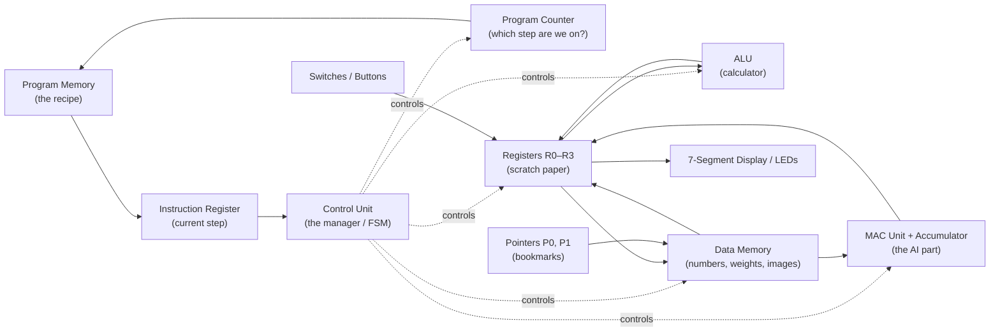
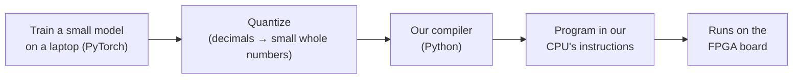

# Project Overview: A Tiny CPU That Can Run a Neural Network

**Course:** CSEN 203L, Digital Systems Design Laboratory
**Board:** Digilent Nexys A7-100T (Xilinx Artix-7 FPGA)
**Team:** Stefanos Bordea & *[partner name]*
**Status:** Design phase. Details may change as the project develops.

---

## 1. The idea in one paragraph

We are designing our own small computer processor (a **CPU**) from scratch and running it on an FPGA board. Our CPU gets one special ability that ordinary simple CPUs don't have: a built-in **multiply-and-add** instruction, the operation that neural networks (AI models) spend almost all their time doing. In the course version, our CPU runs a single artificial "neuron". After the course, the plan is to write a tool that takes a small trained AI model and converts it into a program for our CPU, so the board can recognise handwritten digits. The aim is to learn how AI actually runs on hardware, a field called **ML systems**.

---

## 2. Background you need (no prior knowledge assumed)

### 2.1 What is an FPGA?

Most chips (like the processor in your laptop) are manufactured with a fixed circuit inside that can never change.

An **FPGA** is a chip full of "blank" logic blocks that you can wire together however you want, like a huge box of electronic Lego. You describe the circuit you want in a hardware description language (we use **VHDL**). A tool called **Vivado** turns that description into a configuration file, and the FPGA becomes the circuit you described.

So we are not writing software that runs on a processor. We are **building the processor itself**.

### 2.2 What is a CPU?

A CPU is a machine that follows a list of very simple instructions, one at a time, like a cook following a recipe:

```
1. Put the number 5 in box A
2. Put the number 3 in box B
3. Add box A and box B, put the answer in box A
4. Show box A on the screen
```

Each instruction does something tiny. A CPU looks powerful because it does millions of these steps per second. Our board runs at 100 million clock ticks per second.

### 2.3 What is a neural network?

A neural network is built from many small units called **neurons**. A single neuron does something very simple:

1. Take some input numbers.
2. Multiply each input by a "weight" (a number that says how important that input is).
3. Add all the results together.
4. Make a decision based on the total (for example, "if the total is above 0, answer YES").

**Example:** a neuron that decides whether to take an umbrella.

| Input | Value | Weight (importance) | Input × Weight |
|---|---|---|---|
| How cloudy (0–3) | 2 | 4 | 8 |
| How sunny (0–3) | 3 | −1 | −3 |
| Rain forecast (0 or 1) | 1 | 2 | 2 |
| **Total** | | | **7** |

The total is 7, which is above 0, so the answer is **take the umbrella**.

The weights are not chosen by hand. The network **learns** them from examples during **training**. Once trained, using the network (called **inference**) is just this multiply-and-add, repeated over and over.

A real AI model has millions or billions of these neurons. That means **billions of multiplications and additions** for every answer it gives.

### 2.4 Why AI needs special hardware

Because AI is mostly "multiply, add, repeat", companies build chips designed specifically to do that as fast as possible:

- **GPUs** (e.g. NVIDIA): thousands of small calculators working at the same time.
- **TPUs** (Google): chips built around a grid of multiply-add units.

**ML systems** is the field that sits between AI and hardware. It asks: *how do we make AI models run fast and efficiently on real chips?* It includes designing the chips **and** writing the software tools (**compilers**) that translate AI models into instructions those chips understand.

Our project is a very small, beginner-sized version of both.

---

## 3. What we are building

The project has two parts.

### Part 1: Course project (due December)

An **8-bit CPU** with:

- its own **instruction set** (the list of instructions it understands, designed by us),
- a normal calculator unit (add, subtract, AND, OR, shifts…),
- a special **multiply-accumulate (MAC)** instruction for AI-style maths,
- the switches, buttons, LEDs and 7-segment display on the board for input and output.

**Demo:** the CPU runs a program that acts as **one neuron**. Input values come from the switches, the weights are stored in memory, and the CPU calculates the result and shows the decision on the display.

The board also has a **step-by-step mode**: each button press runs one instruction, so you can watch the CPU work.

### Part 2: After the course (personal extension)

1. **A compiler:** a Python tool that takes a small AI model trained on a computer, converts its weights into small whole numbers, and automatically writes a program for our CPU.
2. **Handwritten digit recognition:** a small model that recognises digits (0–9) from tiny 8×8-pixel images, running on our CPU.
3. **A hardware accelerator** (optional): an extra circuit next to the CPU that does many multiply-adds at once, like a miniature TPU. We would measure how much faster it is.

---

## 4. Architecture overview

"Architecture" means how the parts of the CPU are arranged and connected.

### 4.1 The big picture



### 4.2 Each part in simple terms

| Part | Simple explanation |
|---|---|
| **Program Memory** | Where the program (the list of instructions) is stored. Like the pages of a recipe book. |
| **Program Counter (PC)** | A number that remembers which instruction we're on. Like your finger on the current line of the recipe. |
| **Instruction Register (IR)** | Holds the instruction currently being carried out. |
| **Control Unit** | The "manager" of the CPU. It reads each instruction and tells every other part what to do. It is built as a **finite state machine (FSM)**, a circuit that moves through a fixed set of steps. |
| **Registers (R0–R3)** | Four tiny, very fast storage boxes, each holding one 8-bit number. Like scratch paper for the current calculation. |
| **ALU** (Arithmetic Logic Unit) | The calculator. Does add, subtract, AND, OR, shifts, and so on. |
| **Data Memory** | Bigger storage for numbers: the neuron's weights, input data, results. |
| **Pointers (P0, P1)** | Two "bookmarks" that point to places in data memory. They can move forward automatically, which makes it easy to walk through a list of numbers. |
| **MAC Unit + Accumulator** | The special AI part. Multiplies two numbers and adds the result to a running total. Explained in section 5. |
| **Inputs / Outputs** | Switches and buttons to put numbers in; the 7-segment display and LEDs to show results. |

### 4.3 How one instruction runs

The Control Unit repeats the same cycle for every instruction:


In kitchen terms: **read** the next line of the recipe, **understand** it, **do** it, **put** the result where it belongs, then move on to the next line.

### 4.4 Key numbers (planned)

| Property | Value | What it means |
|---|---|---|
| Data width | 8 bits | Each number is 8 bits: from −128 to +127 |
| Registers | 4 (R0–R3) | Four scratch-paper boxes |
| Instruction size | 16 bits | Each instruction is one 16-bit code |
| Memory addresses | 12 bits | Up to 4,096 memory locations, enough for a small AI model |
| Accumulator | 24 bits | A bigger box for adding up many products without overflowing |

The exact instruction list and bit layouts will be documented in `docs/isa-spec.md`.

---

## 5. The AI part, explained simply

### 5.1 Multiply-Accumulate (MAC)

Remember the neuron: multiply each input by its weight, then add everything up. A **MAC** instruction does one step of that:

> **total = total + (input × weight)**

Our MAC instruction also moves both bookmarks (pointers) forward to the next input and the next weight automatically. To calculate a neuron with 64 inputs, the CPU runs the MAC instruction 64 times in a loop:

```
clear the total
repeat 64 times:
    total = total + (next input × next weight)
turn the total back into a small number and save it
```

Without a MAC instruction, every step would need several separate instructions (load, load, multiply, add, move pointers…). With it, each step is **one instruction**. Real AI chips are built around the same principle.

### 5.2 Why the accumulator is bigger (24 bits)

Our numbers are small (−128 to +127). But when you multiply two of them, the answer can be as big as 16,384, and adding up 64 of those gets even bigger.

If we stored the total in an 8-bit box, it would **overflow**: like a car's odometer rolling over from 999,999 back to 000,000, giving a wrong answer. So the running total lives in a much bigger 24-bit box called the **accumulator**.

### 5.3 Shrinking the answer back down (requantization)

At the end, the total is a big number, but the next layer of the neural network expects small 8-bit numbers again. So we **scale it down** and clip it to fit between −128 and +127. This step is called **requantization**.

### 5.4 Why small whole numbers? (quantization)

AI models are normally trained using decimal numbers like 0.7314. Decimal maths needs big, power-hungry circuits. A common trick in the real industry is to convert the model to use **small whole numbers** (8-bit integers, called **int8**) instead. This is called **quantization**. The model becomes much smaller and faster, and loses only a little accuracy. Phones and many AI chips run models this way, and so will our CPU.

---

## 6. Part 2 in more detail

### 6.1 The compiler: a translator

Writing programs by hand in our CPU's instructions is slow and error-prone. A **compiler** is a translator that does it automatically.



Big companies do exactly this at a much larger scale. For example, NVIDIA's tools translate AI models into instructions for their GPUs.

### 6.2 The accelerator: many calculators at once

Our CPU does **one** multiply-add per instruction. An accelerator does **many at the same time**.

The plan is a small **systolic array**: a grid of mini-calculators (for example 4×4 = 16 of them). Numbers flow through the grid like products on a factory assembly line; each calculator does its multiply-add and passes the numbers on to its neighbour. Google's TPU chip is built around this idea, with a far bigger grid.

We would then measure: *how many clock ticks does a calculation take with the accelerator, compared to without it?*

### 6.3 Connection to GPUs and CUDA

A GPU works on a similar idea: thousands of small calculators doing the same operation on different numbers at the same time. **CUDA** is NVIDIA's programming language for GPUs. As an optional extra, we may write the same calculation in CUDA on a real GPU and compare the approaches.

---

## 7. How our project maps to the real world

| In our project | In the real world |
|---|---|
| MAC instruction | Tensor Cores in NVIDIA GPUs, multiply-add units in every AI chip |
| 24-bit accumulator | Wide accumulators in AI chips to avoid overflow |
| int8 numbers | int8 quantized models on phones and AI accelerators |
| Our Python compiler | AI compilers (e.g. NVIDIA TensorRT, TVM, MLIR, Triton) |
| 4×4 systolic array | Google TPU (a much bigger grid) |
| Pointers that auto-advance | Address generators in DSP and AI chips |

---

## 8. Projects that inspired this design

We are not the first people to learn ML systems by building a "tiny" version of real hardware. These open-source projects follow the same idea and shaped our plan:

| Project | What it is | What we take from it |
|---|---|---|
| [**tiny-gpu**](https://github.com/adam-maj/tiny-gpu) (Adam Majmudar) | A minimal GPU in Verilog, built in about two weeks by someone with no prior chip-design experience. It has its own small instruction set and runs matrix maths programs. | Keep it small, keep it fully documented, and prove it works by running real matrix programs. |
| [**Tiny TPU**](https://www.tinytpu.com) (Chin, Guo, Lin, Sure) | A minimal version of Google's TPU built by four beginners. It uses a 2×2 systolic array and can run and even train a tiny neural network. | Start from the simplest network (a 2→2→1 network that solves XOR), and work things out on paper before writing code. |
| [**TinyTinyTPU**](https://github.com/Alanma23/tinytinyTPU-co) | A 2×2 systolic array running on a Basys3 board, which has the same Artix-7 FPGA family as ours, built with Vivado. | Proof that a small AI accelerator fits on a student FPGA board like ours. |
| [**tiny-tpu**](https://github.com/RightNow-AI/tiny-tpu) (RightNow AI) | An 8×8 systolic array with an assembler and a tool that exports PyTorch models to it. | The full chain from a trained model to hardware, which is the goal of our Part 2 compiler. |

What these projects have in common:
1. **They are small on purpose.** Each strips a huge real system (GPU, TPU) down to the core idea.
2. **They run real AI maths**, not just "hello world": matrix multiplication or a small neural network.
3. **They are documented in public.** The builders wrote up their progress so others could learn from it.

We aim to do the same three things.

---

## 9. Course requirements check

| Requirement | How we meet it |
|---|---|
| Complete system on the Nexys A7-100T | The full CPU runs on the board |
| Combinational logic | ALU, instruction decoder, MAC multiplier, display decoder |
| Sequential logic | Registers, program counter, memory, accumulator |
| Finite state machine at its core | The Control Unit (fetch → decode → execute → write back) |
| At least two board peripherals | Switches, pushbuttons, 7-segment display, LEDs |
| Team of two | Both members design, test and can explain the whole CPU |

---

## 10. Glossary

| Term | Meaning |
|---|---|
| **Accelerator** | An extra circuit built to do one kind of job (like AI maths) much faster |
| **Accumulator** | A register that keeps a running total |
| **ALU** | Arithmetic Logic Unit, the CPU's calculator |
| **Bit** | A single 0 or 1. 8 bits can represent 256 different values |
| **Compiler** | A program that translates from one language into instructions a machine understands |
| **CPU** | Central Processing Unit, a machine that follows instructions one by one |
| **CUDA** | NVIDIA's programming language for GPUs |
| **FPGA** | A reconfigurable chip that can become any digital circuit you describe |
| **FSM** | Finite State Machine, a circuit that moves through a fixed set of steps |
| **GPU** | Graphics Processing Unit, a chip with thousands of small calculators working at the same time |
| **Inference** | Using a trained AI model to get an answer |
| **Instruction set (ISA)** | The complete list of instructions a CPU understands |
| **int8** | An 8-bit whole number, from −128 to +127 |
| **MAC** | Multiply-Accumulate: total = total + (a × b) |
| **ML systems** | The field of making AI run fast and efficiently on hardware |
| **Neuron** | The basic unit of a neural network: multiply inputs by weights, add up, decide |
| **Quantization** | Converting a model's decimal numbers into small whole numbers |
| **Register** | A tiny, very fast storage box inside the CPU |
| **Requantization** | Scaling a big total back down to a small number |
| **Systolic array** | A grid of multiply-add units that pass data along, like an assembly line |
| **Training** | The process where an AI model learns its weights from examples |
| **TPU** | Tensor Processing Unit, Google's AI chip |
| **VHDL** | The language we use to describe our circuits |
| **Weight** | A number inside a neural network that says how important an input is |
